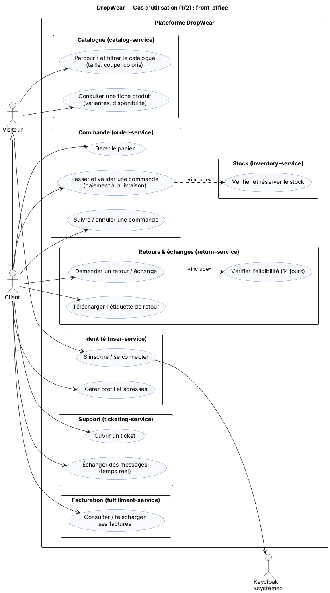
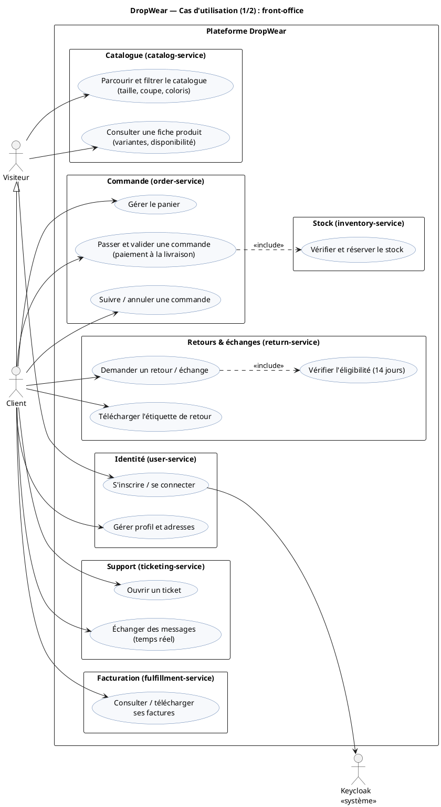
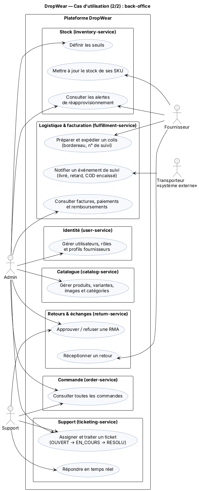
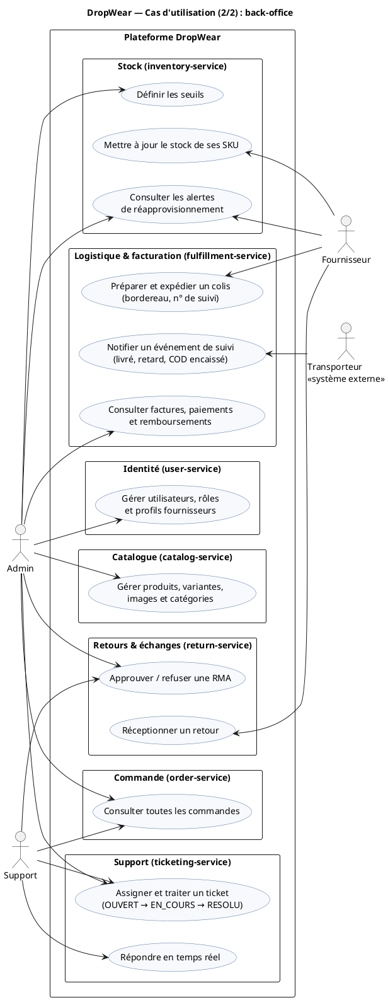

# Livrable 1 — Sujet et analyse fonctionnelle

## 1.1 Sujet

**DropWear** est une plateforme e-commerce de vêtements en **dropshipping** : la plateforme vend sans détenir de stock. Les articles sont expédiés directement par des fournisseurs partenaires.

## 1.2 Problématique réelle

Un e-commerçant de mode en dropshipping fait face à cinq problèmes concrets :

1. **Survente** : le stock appartient au fournisseur. Sans synchronisation ni réservation, deux clients peuvent acheter la dernière pièce, et la commande est annulée après paiement.
2. **Complexité des variantes** : un même modèle existe en plusieurs tailles, coupes (*regular*, *boxy*, *oversize*) et coloris. Chaque combinaison est un SKU distinct avec son propre stock.
3. **Retours fréquents** : la mode en ligne a l'un des taux de retour les plus élevés du e-commerce, surtout à cause des tailles. Un processus RMA clair (éligibilité, étiquette, échange de taille) est indispensable.
4. **Paiement à la livraison (COD)** : majoritaire sur le marché visé. Le paiement n'est acquis qu'à la livraison, donc le suivi du transporteur et le statut de paiement sont liés.
5. **Service client** : les colis endommagés et les retards génèrent des réclamations. Il faut les tracer, les assigner et y répondre rapidement.

**Pourquoi une architecture microservices ?** Les charges sont très inégales (le catalogue est beaucoup lu, les commandes ont des pics pendant les soldes). Les domaines évoluent à des rythmes différents et l'équipe de 6 doit travailler en parallèle. Les microservices permettent un déploiement, une montée en charge et une technologie de stockage **indépendants par domaine**.

## 1.3 Objectifs

- Vendre des articles déclinés en variantes sans survente.
- Couvrir le cycle complet : panier → commande → expédition par le fournisseur → livraison → facture → retour ou échange.
- Gérer le paiement à la livraison et le suivi transporteur.
- Offrir un support client traçable (tickets, messagerie temps réel).
- Sécuriser l'accès par rôle (Keycloak, OAuth2/JWT).

## 1.4 Acteurs

| Acteur | Type | Description |
|--------|------|-------------|
| **Visiteur** | Principal (humain) | Parcourt le catalogue sans compte. |
| **Client** | Principal (humain), hérite de Visiteur | Achète, suit ses commandes, demande des retours ou échanges, contacte le support. |
| **Admin** | Principal (humain) | Gère le catalogue, les utilisateurs, les commandes, les retours, la facturation. |
| **Support** | Principal (humain) | Traite les tickets, répond aux clients, approuve les retours pour colis endommagé. |
| **Fournisseur** | Principal (humain) | Partenaire dropshipping : met à jour son stock, prépare et expédie les colis, réceptionne les retours. |
| **Transporteur** | Secondaire (système externe, simulé) | Envoie les événements de suivi (expédié, en transit, livré, retard) et confirme l'encaissement COD. |
| **Keycloak** | Secondaire (système) | Fournisseur d'identité : authentification, émission des JWT, rôles. |

## 1.5 User stories par acteur

Priorité MoSCoW : **M** = Must, **S** = Should, **C** = Could.

### Visiteur / Client

| ID | En tant que… | je veux… | afin de… | Prio | Service |
|----|--------------|----------|----------|------|---------|
| US-C01 | visiteur | créer un compte et me connecter | acheter et suivre mes commandes | M | user-service + Keycloak |
| US-C02 | client | gérer mon profil et mes adresses de livraison | ne pas les ressaisir à chaque commande | M | user-service |
| US-C03 | visiteur | filtrer le catalogue par catégorie, taille, coupe (boxy, oversize) et coloris | trouver rapidement un article qui me va | M | catalog-service |
| US-C04 | visiteur | voir la fiche produit avec ses variantes, ses images et la disponibilité par taille | choisir en connaissance de cause | M | catalog-service + inventory-service |
| US-C05 | client | ajouter, modifier ou supprimer des articles dans mon panier et voir le total | préparer ma commande | M | order-service |
| US-C06 | client | valider ma commande en paiement à la livraison | payer seulement à réception | M | order-service |
| US-C07 | client | être prévenu immédiatement si une taille n'est plus disponible | ne pas commander un article épuisé | M | order-service → inventory-service |
| US-C08 | client | suivre le statut de ma commande et le numéro de suivi | savoir quand je serai livré | M | order-service + fulfillment-service |
| US-C09 | client | annuler ma commande tant qu'elle n'est pas expédiée | changer d'avis sans frais | S | order-service |
| US-C10 | client | télécharger ma facture | avoir une preuve d'achat | S | fulfillment-service |
| US-C11 | client | demander un retour ou un échange de taille sous 14 jours après livraison | obtenir un article qui me va ou un remboursement | M | return-service |
| US-C12 | client | télécharger l'étiquette de retour | renvoyer le colis facilement | M | return-service |
| US-C13 | client | ouvrir un ticket (colis endommagé, retard) et échanger des messages avec le support | résoudre mon problème | M | ticketing-service |

### Admin

| ID | En tant qu'admin, je veux… | afin de… | Prio | Service |
|----|----------------------------|----------|------|---------|
| US-A01 | créer et modifier des produits, des variantes (taille, coupe, coloris) et des images | alimenter le catalogue | M | catalog-service |
| US-A02 | organiser les catégories (Hauts › T-shirts…) | faciliter la navigation | M | catalog-service |
| US-A03 | gérer les utilisateurs, leurs rôles et les profils fournisseurs | contrôler les accès | M | user-service |
| US-A04 | consulter et filtrer toutes les commandes | piloter l'activité | M | order-service |
| US-A05 | définir les seuils de réapprovisionnement et voir les alertes | éviter les ruptures | S | inventory-service |
| US-A06 | approuver ou refuser une demande de retour | contrôler les remboursements | M | return-service |
| US-A07 | consulter factures, paiements et remboursements, et encaisser manuellement un COD | suivre la trésorerie | S | fulfillment-service |

### Support

| ID | En tant qu'agent support, je veux… | afin de… | Prio | Service |
|----|------------------------------------|----------|------|---------|
| US-S01 | voir la file des tickets filtrée par statut, catégorie et priorité | traiter les urgences d'abord | M | ticketing-service |
| US-S02 | m'assigner un ticket ou l'assigner à un collègue | répartir la charge | M | ticketing-service |
| US-S03 | répondre au client en temps réel | résoudre plus vite | M | ticketing-service (WebSocket) |
| US-S04 | passer un ticket à En cours puis à Résolu | tracer le traitement | M | ticketing-service |
| US-S05 | voir la commande liée au ticket | comprendre le contexte | S | ticketing-service → order-service |
| US-S06 | approuver un retour pour colis endommagé | dédommager le client | S | return-service |

### Fournisseur

| ID | En tant que fournisseur, je veux… | afin de… | Prio | Service |
|----|-----------------------------------|----------|------|---------|
| US-F01 | mettre à jour la quantité disponible de mes SKU | éviter les ventes d'articles que je n'ai plus | M | inventory-service |
| US-F02 | voir mes alertes de réapprovisionnement | anticiper les ruptures | S | inventory-service |
| US-F03 | voir les expéditions à préparer avec le bordereau | expédier vite | M | fulfillment-service |
| US-F04 | déclarer un colis expédié avec le transporteur et le n° de suivi | informer le client | M | fulfillment-service |
| US-F05 | déclarer un retour reçu et l'état des articles | déclencher le remboursement ou l'échange | M | return-service |

### Transporteur (système externe simulé)

| ID | En tant que transporteur, je veux… | afin de… | Prio | Service |
|----|------------------------------------|----------|------|---------|
| US-T01 | notifier les événements de suivi (en transit, livré, retard) | tenir le statut à jour | M | fulfillment-service |
| US-T02 | confirmer l'encaissement du paiement à la livraison | solder la facture | M | fulfillment-service |

## 1.6 Règles de gestion (conception, sans implémentation de logique)

| ID | Règle |
|----|-------|
| RG1 | Le prix d'un article est toujours relu côté serveur auprès du catalogue (S1). Le prix envoyé par le front est ignoré. Il est figé (*snapshot*) dans la ligne de panier puis dans la ligne de commande. |
| RG2 | La validation d'une commande réserve le stock pour 30 min. La réservation est confirmée (décrément définitif) à la réception de `CommandeValideeEvent`, ou libérée à l'annulation ou à l'expiration. |
| RG3 | Une commande est annulable seulement au statut `EN_ATTENTE` ou `CONFIRMEE` (avant expédition). |
| RG4 | Un retour est éligible si la commande est `LIVREE` et si la demande arrive au plus tard 14 jours après `deliveredAt`. |
| RG5 | Un échange réserve immédiatement la taille de remplacement. Si elle est indisponible, un remboursement est proposé. |
| RG6 | En paiement à la livraison, le paiement passe à `PAYE` à la livraison confirmée par le transporteur. |
| RG7 | Une alerte de réapprovisionnement est créée quand le disponible devient inférieur ou égal au seuil du SKU. |
| RG8 | Un ticket suit `OUVERT → EN_COURS → RESOLU`. Un retard de livraison détecté crée un ticket automatiquement (source `SYSTEME`). |

## 1.7 Périmètre

| Dans le périmètre (V1) | Hors périmètre (perspectives) |
|------------------------|-------------------------------|
| Comptes, rôles et adresses (Keycloak + user-service) | Paiement par carte réel (simulé en *sandbox*) |
| Catalogue avec variantes et images (URL) | API transporteur réelle (simulée par un client Keycloak `carrier-simulator`) |
| Panier, commande, cycle de vie complet | Notifications e-mail et SMS (futur `notification-service`) |
| Réservation, décrément, alertes de stock | Recommandations, avis clients, promotions |
| RMA : retour, échange, étiquette, remboursement par avoir | Multi-devise, multi-langue |
| Tickets et messagerie temps réel | Application mobile |
| Factures, paiements COD et carte simulée, suivi colis | Cache Redis, Elasticsearch (voir P2 dans 00) |
| Docker Compose, Gateway, Eureka, Config Server, Kafka | Kubernetes, CI/CD avancée |

> Rappel : à la Validation 1, la **conception** est évaluée. Aucune logique métier n'est attendue. Les projets Spring Boot créés exposent les endpoints sous forme de squelettes (réponse `501 Not Implemented`).

## 1.8 Diagrammes de cas d'utilisation

Le diagramme est découpé en deux vues pour rester lisible à l'écran : un diagramme unique, avec 6 acteurs et 25 cas, devient illisible en soutenance. Chaque package correspond à un microservice, ce qui annonce le découpage du livrable 2.

### Vue 1 — Front-office (Visiteur, Client)

<!-- BEGIN puml:uc-front-office -->

Code PlantUML — <code>Diagrams/src/uc-front-office.puml</code>

<!-- END puml:uc-front-office -->

### Vue 2 — Back-office (Admin, Support, Fournisseur, Transporteur)

<!-- BEGIN puml:uc-back-office -->

Code PlantUML — <code>Diagrams/src/uc-back-office.puml</code>

<!-- END puml:uc-back-office -->
