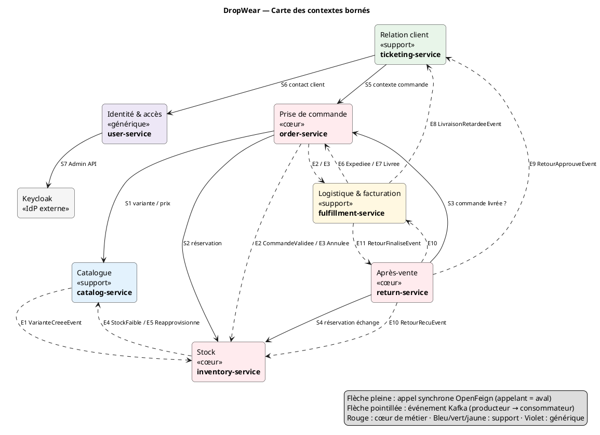

# Livrable 2 — Découpage en microservices

## 2.1 Méthode

Le découpage suit le **Domain-Driven Design** (DDD) :

1. On identifie les **sous-domaines** métier à partir des user stories (livrable 1).
2. Chaque sous-domaine devient un **contexte borné** (*bounded context*) : une frontière à l'intérieur de laquelle les termes ont un sens unique (langage omniprésent).
3. Un contexte borné = un microservice = une base de données privée.
4. Les contextes communiquent par **API** (OpenFeign) quand une réponse immédiate est nécessaire, sinon par **événements** (Kafka).

| Type de sous-domaine | Contextes | Signification |
|----------------------|-----------|---------------|
| **Cœur de métier** (*core*) | Commande, Stock, Retours & échanges | Ce qui différencie DropWear : zéro survente, échange de taille simple. |
| **Support** | Catalogue, Logistique & facturation, Relation client | Indispensable, mais moins différenciant. |
| **Générique** | Identité & accès | Délégué en grande partie à Keycloak. |

## 2.2 Tableau de découpage

| Service | Responsabilité | Contexte borné | Base | Justification de la base |
|---------|----------------|----------------|------|--------------------------|
| **user-service** (commun) | Profils, adresses, rôles, profils fournisseurs. Pilotage de Keycloak (création de comptes, rôles). | Identité & accès | **PostgreSQL** | Données relationnelles stables (utilisateur → adresses → profil fournisseur), contrainte d'unicité sur l'e-mail, identifiant = `sub` Keycloak. Les mots de passe restent dans Keycloak. |
| **catalog-service** | Produits, catégories, variantes (taille, coupe, coloris), images. Recherche et filtres. | Catalogue | **MongoDB** | Document produit auto-portant (variantes et images imbriquées) lu en une requête. Attributs variables selon le type de vêtement. Charge essentiellement en lecture. Index texte. |
| **order-service** | Panier, calcul du total, création, validation, annulation et cycle de vie de la commande. | Prise de commande | **PostgreSQL** | Transactions ACID sur commande + lignes + outbox, verrou optimiste (`@Version`), requêtes par statut et date. |
| **inventory-service** | Stock par SKU, réservation temporaire, décrémentation définitive, mouvements, alertes de réapprovisionnement. | Stock | **PostgreSQL** | Concurrence forte sur un même SKU : verrouillage de ligne et transaction atomique « réserver + mettre à jour ». Redis n'est pas retenu (voir P2 dans 00). |
| **return-service** | Workflow RMA, éligibilité 14 jours, étiquettes de retour, échanges de taille. | Après-vente | **MySQL** | Workflow à états très structuré (RMA → articles → étiquette), intégrité référentielle. MySQL diversifie la stack imposée. |
| **ticketing-service** | Tickets, messagerie temps réel (WebSocket), assignation, statuts. | Relation client | **MongoDB** | Un ticket et son fil de messages forment un document naturel (messages imbriqués, pièces jointes). Schéma souple selon la catégorie. Écritures fréquentes. |
| **fulfillment-service** | Expéditions par fournisseur, bordereaux, suivi transporteur. Factures, avoirs, paiements (COD, carte simulée), remboursements. | Logistique & facturation | **PostgreSQL** | Données financières : ACID, numérotation séquentielle des factures, contraintes fortes, montants `NUMERIC`. |

Infrastructure (pas de logique métier) : `api-gateway`, `eureka-server`, `config-server`, `keycloak`, `kafka`.

## 2.3 Justification du découpage

### Découpage par contexte, pas par table

Le même concept métier existe dans plusieurs contextes, avec **un modèle différent dans chacun**. Les services partagent un **identifiant** (le SKU, l'`orderId`), jamais une table.

| Concept | Catalogue | Commande | Stock | Après-vente | Logistique |
|---------|-----------|----------|-------|-------------|------------|
| **Article / SKU** | `Variant` : taille, coupe, coloris, images, prix | `OrderLine` : instantané du nom et du prix au moment de l'achat | `StockItem` : quantités physique et réservée, seuil | `ReturnItem` : état à la réception, SKU de remplacement | `ShipmentItem` : quantité à expédier |
| **Commande** | – | `Order` : agrégat avec son cycle de vie | `StockReservation` : référence `orderId` | `ReturnRequest.orderId` + date de livraison copiée | `Shipment`, `Invoice`, `Payment` par `orderId` |
| **Client** | – | `customerId` (= `sub` du JWT) | – | `customerId` | `customerId` |

Un découpage par table aurait produit un `product-service`, un `variant-service`, un `order-line-service`… Ce sont des services bavards, sans autonomie, qui partagent des transactions. C'est l'anti-pattern du **monolithe distribué**.

### Critères de cohérence vérifiés

| Critère | Vérification |
|---------|--------------|
| **Forte cohésion** | Chaque service porte un seul processus métier (ex. tout le workflow RMA est dans return-service). |
| **Faible couplage** | 6 appels synchrones seulement, tous protégés par Resilience4j. Le reste passe par 11 événements. |
| **Autonomie des données** | Aucune base partagée, aucune jointure entre services. Les données externes sont copiées (*snapshot*) ou demandées via l'API. |
| **Autonomie d'équipe** | 1 service = 1 propriétaire. Les contrats (API et événements) sont figés dans ce dossier. |
| **Agrégats** | Une transaction ne modifie qu'un agrégat d'un seul service (`Order`, `StockReservation`, `ReturnRequest`, `Ticket`, `Shipment`, `Invoice`). |
| **Pas de transaction distribuée** | Les processus longs (commande, retour) sont des **sagas par chorégraphie**. |

### Choix discutables, assumés et justifiés

| Choix | Justification | Alternative écartée |
|-------|---------------|---------------------|
| Panier dans order-service | Le panier est l'antichambre de la commande (même langage, même client, même prix figé). Un `cart-service` séparé doublerait les appels pour peu de valeur. | `cart-service` séparé |
| Fulfillment **et** Billing dans le même service | Avec le paiement à la livraison, l'encaissement est un événement de livraison. Deux packages internes indépendants permettent de les séparer plus tard. | Deux services (impossible à 6 membres) |
| Pas de service Fournisseur | Le fournisseur est un **acteur**, pas un domaine. Ses cas d'utilisation relèvent du stock, de la logistique et des retours (voir P1 dans 00). | `supplier-service` (7ᵉ service sans propriétaire) |
| Identité dans user-service + Keycloak | Keycloak gère l'authentification et les secrets. user-service gère les données métier du compte (adresses, profil fournisseur). | Tout dans Keycloak (attributs personnalisés peu requêtables) |

## 2.4 Carte des contextes (*context map*)

Les flèches pleines sont des appels synchrones (OpenFeign) : l'appelant est **en aval** (*downstream*). Les flèches pointillées sont des événements Kafka (*published language*).

<!-- BEGIN puml:context-map -->

Code PlantUML — <code>Diagrams/src/context-map.puml</code>

<!-- END puml:context-map -->

Lecture : le **Catalogue** et la **Commande** sont en amont de presque tous les autres contextes. Les contextes **Stock** et **Logistique** réagissent aux événements de la commande sans la connaître. L'**Après-vente** est en aval de la commande (éligibilité) et du stock (échange).
