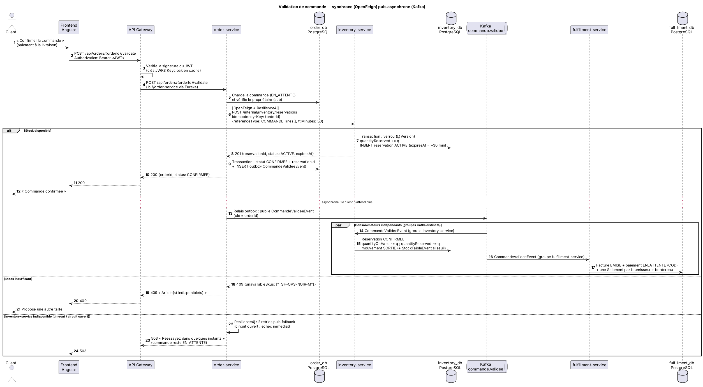
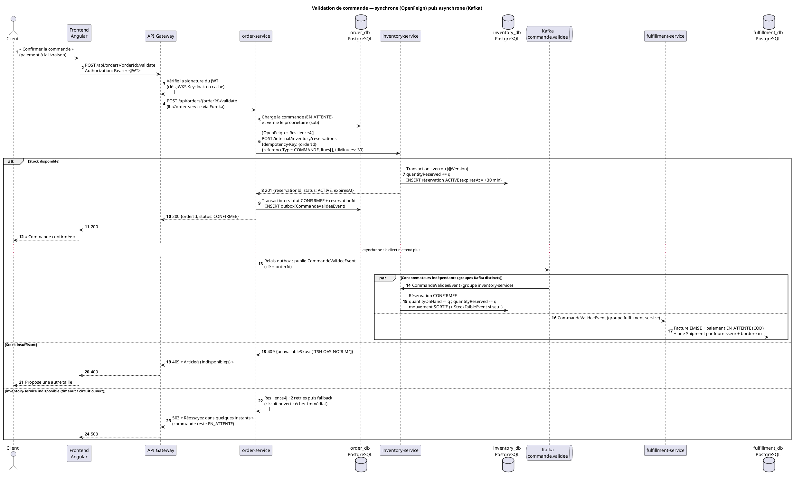
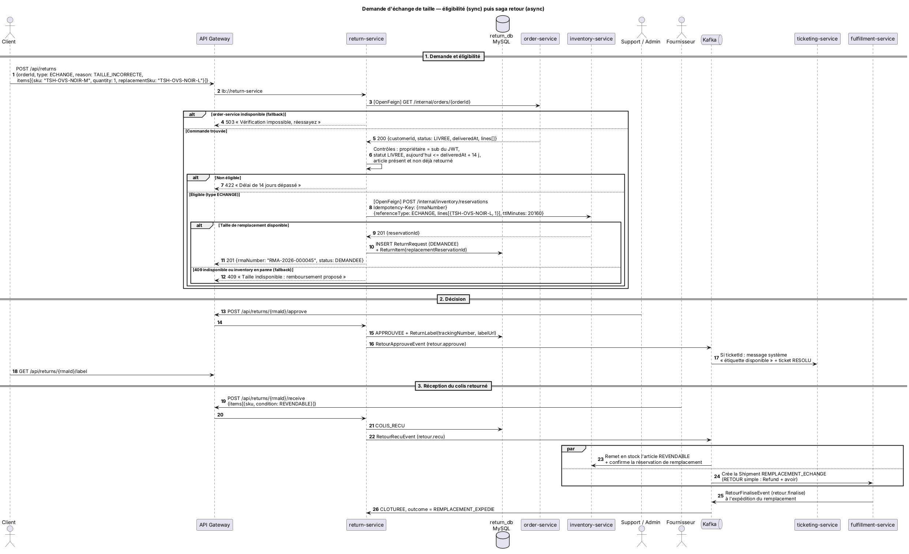
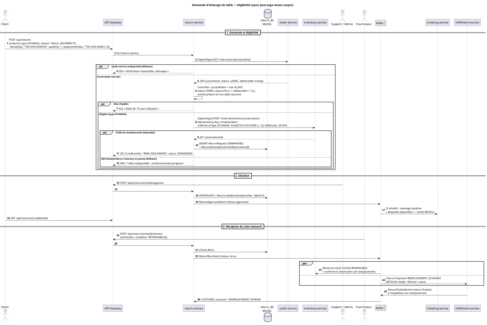

# Livrable 4 — Matrice des interactions

## 4.1 Règle de choix synchrone / asynchrone

| On choisit le **synchrone** (OpenFeign) quand… | On choisit l'**asynchrone** (Kafka) quand… |
|-----------------------------------------------|---------------------------------------------|
| l'appelant **ne peut pas répondre à l'utilisateur** sans la réponse (ex. « la taille est-elle disponible ? ») | l'appelant **informe** d'un fait accompli (« la commande est validée ») |
| la donnée doit être **fraîche et faisant foi** (prix, date de livraison) | **plusieurs services** réagissent au même fait (Inventory **et** Fulfillment) |
| l'échec doit être **visible immédiatement** (409, 503) | le traitement peut être **différé** sans gêner l'utilisateur (préparer un colis) |
| | on veut **découpler la disponibilité** : le consommateur peut être arrêté sans bloquer le producteur |

**Résultat :** 6 appels synchrones entre services, plus 1 vers Keycloak, tous en lecture ou en réservation. Les 11 événements portent les faits métier.

## 4.2 Matrice des appels synchrones (OpenFeign + Resilience4j)

| ID | Appelant → appelé | Endpoint | Données envoyées → reçues | Justification | Comportement en panne |
|----|-------------------|----------|---------------------------|---------------|-----------------------|
| S1 | order-service → catalog-service | `GET /internal/catalog/variants/{sku}` | `sku` → `{productId, productName, size, fit, color, unitPrice, currency, supplierId, active}` | Le prix et le fournisseur font foi côté serveur. Le client ne peut pas falsifier le prix. | Timeout 2 s, retry ×2, CB `catalog`. Fallback : **503**, article non ajouté. |
| S2 | order-service → inventory-service | `POST /internal/inventory/reservations` | `{referenceType: COMMANDE, referenceId: orderId, lines[{sku, quantity}], ttlMinutes: 30}` + `Idempotency-Key` → `{reservationId, status, expiresAt}` ou 409 `{unavailableSkus[]}` | Le client doit savoir **immédiatement** si la commande est acceptée. La réservation évite la survente. | Timeout 3 s, retry ×2 (idempotent), CB `inventory`. Fallback : commande **reste `EN_ATTENTE`**, **503**. |
| S3 | return-service → order-service | `GET /internal/orders/{orderId}` | `orderId` → `{customerId, status, deliveredAt, lines[]}` | L'éligibilité (14 jours, propriétaire, articles) exige des données faisant foi. | Timeout 2 s, retry ×2, CB `order`. Fallback : **503**, aucune RMA créée. |
| S4 | return-service → inventory-service | `POST /internal/inventory/reservations` | `{referenceType: ECHANGE, referenceId: rmaNumber, lines[{replacementSku, quantity}], ttlMinutes: 20160}` → `{reservationId}` | Garantir au client que la taille de remplacement lui est réservée. | Timeout 3 s, retry ×2, CB `inventory`. Fallback : **409** « remboursement proposé ». |
| S5 | ticketing-service → order-service | `GET /internal/orders/{orderId}` | `orderId` → `{customerId, orderNumber, status}` | Vérifier que la commande appartient au client et afficher le contexte à l'agent. | Timeout 2 s, retry ×2, CB `order`. Fallback **dégradé** : ticket créé avec `orderVerified = false`. |
| S6 | ticketing-service → user-service | `GET /internal/users/{userId}` | `userId` → `{fullName, email, phone}` | Un ticket automatique (issu d'E8) n'a pas de JWT client, donc pas de nom ni d'e-mail. | Timeout 2 s, retry ×2, CB `user`. Fallback : ticket sans coordonnées, enrichi plus tard. |
| S7 | user-service → Keycloak Admin API | `POST /admin/realms/dropwear/users`, `…/role-mappings/realm` | `UserRepresentation` → `201 Location` | Keycloak est la source de vérité des comptes. | Timeout 3 s, CB `keycloak-admin`. Fallback : **503**, compensation si besoin. |

**Sécurité des appels :** `/internal/**` n'est pas routé par la Gateway. Feign ajoute un jeton *client credentials* (rôle `SERVICE`) obtenu auprès de Keycloak via `OAuth2AuthorizedClientManager`. L'appelé vérifie `hasRole('SERVICE')`.

## 4.3 Matrice des échanges asynchrones (Kafka)

| ID | Événement | Topic (clé) | Producteur | Consommateur(s) (groupe) | Données | Justification |
|----|-----------|-------------|-----------|--------------------------|---------|---------------|
| E1 | `VarianteCreeeEvent` | `catalogue.variante-creee` (sku) | catalog | inventory (`inventory-service`) | `productId, sku, supplierId, size, fit, color` | Le stock d'un nouveau SKU est créé sans couplage au catalogue. |
| E2 | `CommandeValideeEvent` | `commande.validee` (orderId) | order | inventory, fulfillment | commande complète | **Un fait, deux réactions indépendantes** (décrément, préparation). Le client n'attend pas. |
| E3 | `CommandeAnnuleeEvent` | `commande.annulee` (orderId) | order | inventory, fulfillment | `orderId, reservationId, reason` | Compensation de la saga commande. |
| E4 | `StockFaibleEvent` | `stock.faible` (sku) | inventory | catalog | `sku, productId, available, threshold` | Vue locale « stock faible » dans le catalogue, sans appel synchrone à chaque affichage. |
| E5 | `StockReapprovisionneEvent` | `stock.reapprovisionne` (sku) | inventory | catalog | `sku, productId, available` | Retrait du badge. |
| E6 | `CommandeExpedieeEvent` | `livraison.expediee` (orderId) | fulfillment | order | `orderId, carrier, trackingNumber, shippedAt` | Mise à jour du cycle de vie de la commande. |
| E7 | `CommandeLivreeEvent` | `livraison.livree` (orderId) | fulfillment | order | `orderId, deliveredAt` | `LIVREE` + point de départ des 14 jours. |
| E8 | `LivraisonRetardeeEvent` | `livraison.retardee` (orderId) | fulfillment | ticketing | `orderId, customerId, trackingNumber, expectedDate, delayDays` | Support proactif : ticket automatique. |
| E9 | `RetourApprouveEvent` | `retour.approuve` (rmaId) | return | ticketing | `rmaId, rmaNumber, ticketId, trackingNumber` | Mise à jour du ticket lié, sans couplage. |
| E10 | `RetourRecuEvent` | `retour.recu` (rmaId) | return | inventory, fulfillment | `rmaId, type, items[], refundAmount` | Deux réactions : remise en stock, remboursement ou remplacement. |
| E11 | `RetourFinaliseEvent` | `retour.finalise` (rmaId) | fulfillment | return | `rmaId, outcome, refundId?, shipmentId?` | Clôture de la saga retour. |

### Format commun des événements (enveloppe)

```json
{
  "eventId": "6f1c0c1e-…",
  "eventType": "CommandeValideeEvent",
  "occurredAt": "2026-11-20T10:15:30Z",
  "source": "order-service",
  "version": 1,
  "payload": { "orderId": "…", "orderNumber": "DW-2026-000123", "…": "…" }
}
```

## 4.4 Politique de résilience commune

| Mécanisme | Paramètres (Config Server, `application.yml` partagé) | Rôle |
|-----------|-------------------------------------------------------|------|
| **Timeout** (Feign) | `connectTimeout: 1000 ms`, `readTimeout: 2000 ms` (3000 ms pour les réservations) | Ne jamais bloquer un thread indéfiniment. |
| **Retry** (Resilience4j, à l'intérieur du circuit breaker) | `maxAttempts: 3`, `waitDuration: 500 ms`, backoff exponentiel ×2. Uniquement sur `IOException`, `TimeoutException`, 5xx. **Jamais sur 4xx** | Absorber les erreurs transitoires. Les POST ne sont rejoués que s'ils sont idempotents (`Idempotency-Key`). |
| **Circuit breaker** (Resilience4j) | Fenêtre glissante de 10 appels, `failureRateThreshold: 50 %`, `slowCallDurationThreshold: 2 s`, `waitDurationInOpenState: 10 s`, `permittedNumberOfCallsInHalfOpenState: 3` | Couper vite un service en panne pour éviter la cascade et le laisser redémarrer. |
| **Fallback** | Une méthode par client Feign (`FallbackFactory`) | Réponse métier explicite : 503, mode dégradé ou alternative (remboursement). |
| **Producteur Kafka** | `acks=all`, `enable.idempotence=true` + **Transactional Outbox** | Aucun événement perdu, même si Kafka est arrêté. |
| **Consommateur Kafka** | `DefaultErrorHandler` : 3 retries (1 s, 2 s, 4 s) puis `DeadLetterPublishingRecoverer` → `<topic>.DLT`. Idempotence par `eventId` | Pas de message « poison » bloquant, pas de double traitement. |
| **Ordre** | Clé de partition = identifiant de l'agrégat (`orderId`, `rmaId`, `sku`) | Les événements d'une même commande sont traités dans l'ordre. |

## 4.5 Diagramme de séquence 1 — Validation de commande

<!-- BEGIN puml:seq-validation-commande -->


<details>
<summary>Code PlantUML — <code>Diagrams/src/seq-validation-commande.puml</code></summary>



</details>
<!-- END puml:seq-validation-commande -->

**Points à commenter à l'oral :**
1. La réservation (S2) est **synchrone** : c'est la seule information sans laquelle on ne peut pas répondre au client.
2. Le statut `CONFIRMEE` et l'événement sont écrits dans **la même transaction** (outbox).
3. Inventory et Fulfillment réagissent **en parallèle et indépendamment** au même événement.
4. Si inventory est en panne, la commande reste `EN_ATTENTE` : aucune survente possible.

## 4.6 Diagramme de séquence 2 — Demande d'échange (et de retour)

<!-- BEGIN puml:seq-retour-echange -->


<details>
<summary>Code PlantUML — <code>Diagrams/src/seq-retour-echange.puml</code></summary>



</details>
<!-- END puml:seq-retour-echange -->

**Points à commenter à l'oral :**
1. L'éligibilité est vérifiée sur des données **faisant foi** (S3). Sans elles, on refuse (503) au lieu de deviner.
2. Pour un échange, la taille de remplacement est **réservée dès la demande** (S4).
3. La suite est une **saga par chorégraphie** : `RetourApprouveEvent → RetourRecuEvent → RetourFinaliseEvent`.
4. Un **retour simple** suit le même chemin sans l'étape S4. Fulfillment rembourse (avoir + `Refund`) au lieu d'expédier un remplacement.
