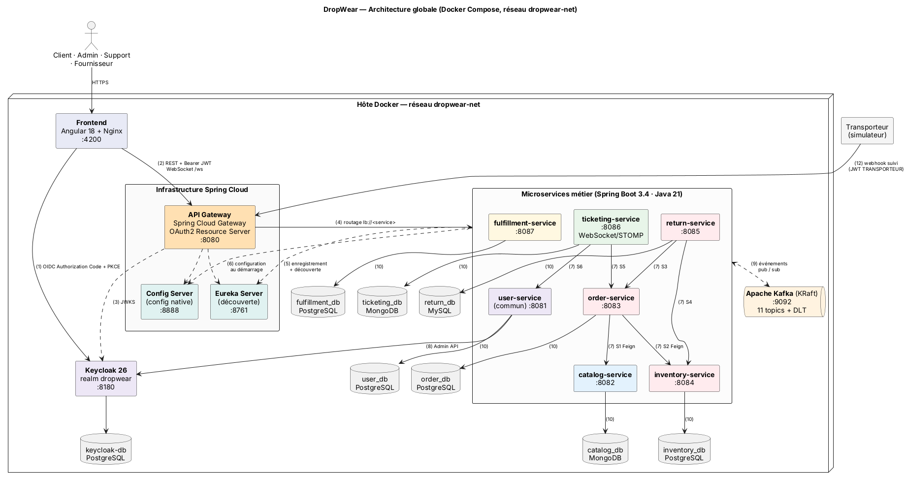
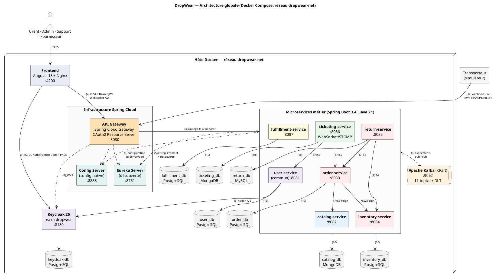

# Livrable 5 — Architecture globale

<!-- BEGIN puml:architecture-globale -->

Code PlantUML — <code>Diagrams/src/architecture-globale.puml</code>

<!-- END puml:architecture-globale -->

## 5.1 Composants

| Composant | Technologie | Rôle |
|-----------|-------------|------|
| Frontend | Angular 18, `keycloak-angular`, servi par Nginx | Interfaces client, admin, support et fournisseur. Obtient le JWT auprès de Keycloak et l'envoie à la Gateway. |
| API Gateway | Spring Cloud Gateway (réactif) | **Point d'entrée unique** : routage vers les services (via Eureka), validation du JWT, CORS, routage WebSocket. Les chemins `/internal/**` ne sont pas exposés. |
| Eureka Server | Spring Cloud Netflix Eureka | **Annuaire** : chaque instance s'enregistre et la Gateway et Feign résolvent `lb://<service>`. Aucune adresse IP n'est codée en dur, et on peut lancer plusieurs instances. |
| Config Server | Spring Cloud Config (profil `native`, dossier `config/`) | **Configuration centralisée** : URL des bases, Kafka, Resilience4j et Keycloak par service et par profil (`default`, `docker`). |
| Keycloak | Keycloak 26, realm `dropwear` (importé au démarrage) | **Fournisseur d'identité** OAuth2 / OpenID Connect : connexion, JWT signés, rôles, comptes de service. |
| Kafka | Apache Kafka 3.8 en mode KRaft (sans Zookeeper) | **Broker** d'événements : 11 topics métier + topics `*.DLT`, rétention de 7 jours. |
| Microservices | Spring Boot 3.4, Java 21, OpenFeign, Resilience4j, Spring Kafka | Logique de chaque contexte borné. |
| Bases | 4 PostgreSQL 16, 1 MySQL 8.4, 2 MongoDB 7 (un conteneur par base) | Persistance privée de chaque service. |
| Docker | Un `Dockerfile` par service, `docker-compose.yml` à la racine | Exécution reproductible de toute la plateforme sur un réseau isolé `dropwear-net`. |

## 5.2 Explication des flux

| # | Flux | Explication |
|---|------|-------------|
| 1 | Front → Keycloak | Le navigateur est redirigé vers la page de connexion Keycloak (*Authorization Code + PKCE*). Keycloak renvoie un **access token JWT** (5 min) et un refresh token. |
| 2 | Front → Gateway | Toutes les requêtes REST passent par `http://localhost:8080/api/...` avec `Authorization: Bearer <JWT>`. La messagerie du support utilise `ws://localhost:8080/ws`. |
| 3 | Gateway → Keycloak | La Gateway récupère une fois les **clés publiques JWKS**, puis vérifie localement la signature, l'expiration et l'émetteur de chaque jeton. Elle rejette les requêtes non authentifiées (401). |
| 4 | Gateway → services | Routage par préfixe (`/api/orders/**` → `lb://order-service`). Le jeton est transmis et chaque service le revérifie et applique ses règles de rôle (`@PreAuthorize`). |
| 5 | Services → Eureka | Au démarrage, chaque service s'enregistre (nom + adresse) et envoie un *heartbeat* toutes les 30 s. Feign et la Gateway interrogent Eureka pour trouver une instance (répartition de charge côté client). |
| 6 | Services → Config Server | Au démarrage, chaque service charge sa configuration (`spring.config.import=configserver:`) : `application.yml` commun + `<service>.yml`. |
| 7 | Service → service (S1 à S6) | Appels synchrones **OpenFeign** sur `/internal/**`, protégés par Resilience4j (timeout, retry, circuit breaker, fallback) et authentifiés par un jeton *client credentials* (rôle `SERVICE`). |
| 8 | user-service → Keycloak | API d'administration de Keycloak : création des comptes, attribution des rôles, désactivation. |
| 9 | Services ↔ Kafka | Publication et consommation des événements de domaine (E1 à E11). Chaque service consomme avec son propre *consumer group*. |
| 10 | Service → sa base | Chaque service accède **uniquement** à sa base, avec ses propres identifiants. Aucune autre application n'y a accès. |
| 11 | Docker | Tous les conteneurs partagent le réseau `dropwear-net`. Seuls le front (4200), la Gateway (8080), Keycloak (8180) et les consoles d'administration (Eureka 8761, Kafka UI 8090) sont exposés sur l'hôte. |
| 12 | Transporteur → Gateway | Le simulateur de transporteur obtient un jeton (*client credentials*, rôle `TRANSPORTEUR`) et appelle `POST /api/fulfillment/carrier-events`. |

## 5.3 Table de routage de la Gateway

| Prédicat `Path` | Destination |
|-----------------|-------------|
| `/api/users/**` | `lb://user-service` |
| `/api/catalog/**` | `lb://catalog-service` |
| `/api/cart/**`, `/api/orders/**` | `lb://order-service` |
| `/api/inventory/stocks/**`, `/api/inventory/alerts/**`, `/api/inventory/movements/**` | `lb://inventory-service` |
| `/api/returns/**` | `lb://return-service` |
| `/api/tickets/**` | `lb://ticketing-service` |
| `/ws/**` | `lb:ws://ticketing-service` |
| `/api/fulfillment/**` | `lb://fulfillment-service` |
| `/internal/**` | **aucune route** (accès refusé depuis l'extérieur) |

## 5.4 Ordre de démarrage (Docker Compose)

1. Bases de données, Kafka, `keycloak-db`
2. Keycloak (import du realm `dropwear-realm.json`)
3. `config-server` (*healthcheck* `/actuator/health`)
4. `eureka-server`
5. Microservices (dépendent de leur base, de Kafka, du Config Server et d'Eureka)
6. `api-gateway`
7. `frontend`
