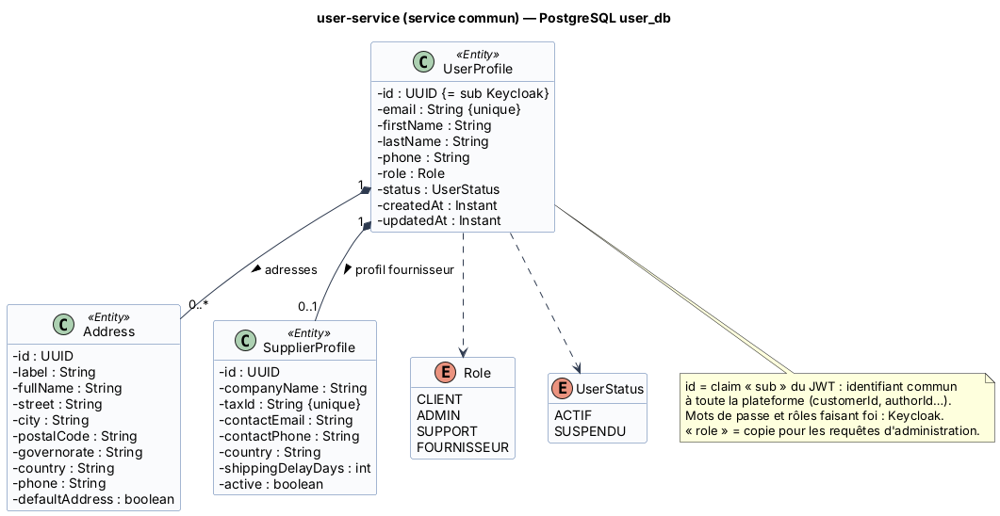

# Fiche 0 — Service commun « Auth & Gestion des utilisateurs » (`user-service`)

| Élément | Valeur |
|---------|--------|
| Nom technique | `user-service` (port 8081) |
| Contexte borné | Identité & accès (sous-domaine générique) |
| Base | PostgreSQL `user_db` (conteneur `user-db`) |
| Routes Gateway | `/api/users/**` |
| Endpoints internes | `/internal/users/**` (rôle `SERVICE`, non routés par la Gateway) |
| Développé par | Toute l'équipe (répartition dans le livrable 06) |
| Présenté par | **Med Ben Lakhal** |

## 1. Responsabilités

**Fait :**
- Inscription : création du compte dans **Keycloak** (Admin REST API), puis création du profil local.
- Profil courant (`/me`) : création automatique au premier appel à partir des *claims* du JWT (*just-in-time provisioning*) si le profil n'existe pas.
- Carnet d'adresses de livraison (CRUD, adresse par défaut).
- Administration : liste des utilisateurs, changement de rôle (répercuté dans Keycloak), suspension (compte Keycloak désactivé).
- Profils fournisseurs (raison sociale, matricule fiscal, délai d'expédition).
- Fourniture des coordonnées d'un client aux autres services (`/internal/users/{userId}`).

**Ne fait pas :** l'authentification, le stockage des mots de passe ni l'émission des jetons (c'est le rôle de Keycloak).

## 2. Sécurité : Keycloak (OAuth2 / OpenID Connect / JWT)

| Élément | Configuration |
|---------|---------------|
| Realm | `dropwear` |
| Rôles du realm | `CLIENT`, `ADMIN`, `SUPPORT`, `FOURNISSEUR` (humains) · `SERVICE` (comptes de service) · `TRANSPORTEUR` (simulateur) |
| Client `dropwear-frontend` | Public, *Authorization Code + PKCE*, redirect `http://localhost:4200/*` |
| Clients `order-service`, `return-service`, `ticketing-service` | Confidentiels, *client credentials*, rôle `SERVICE` (appels `/internal/**`) |
| Client `user-service` | Confidentiel, *service account* avec `realm-management: manage-users, view-users` + rôle `SERVICE` |
| Client `carrier-simulator` | Confidentiel, *client credentials*, rôle `TRANSPORTEUR` |
| Durées de vie | Access token 5 min · refresh token 30 min |
| Claims utilisés | `sub` (= `UserProfile.id` = `customerId` partout), `email`, `given_name`, `family_name`, `realm_access.roles` |

**Validation des jetons :** la Gateway **et** chaque service sont des *OAuth2 Resource Servers* (défense en profondeur). La signature est vérifiée localement avec les clés publiques JWKS de Keycloak, mises en cache. Il n'y a donc pas d'appel à Keycloak à chaque requête. Un convertisseur transforme `realm_access.roles` en autorités `ROLE_*` pour `@PreAuthorize`.

## 3. Entités et attributs

| Entité | Attributs principaux | Remarques |
|--------|---------------------|-----------|
| `UserProfile` | `id` (= `sub` Keycloak, non généré), `email` (unique), `firstName`, `lastName`, `phone`, `role`, `status`, `createdAt`, `updatedAt` | Racine d'agrégat |
| `Address` | `id`, `label`, `fullName`, `street`, `city`, `postalCode`, `governorate`, `country`, `phone`, `defaultAddress` | 0..* par utilisateur |
| `SupplierProfile` | `id`, `companyName`, `taxId` (unique), `contactEmail`, `contactPhone`, `country`, `shippingDelayDays`, `active` | 0..1 par utilisateur de rôle `FOURNISSEUR` |
| `Role` (enum) | `CLIENT`, `ADMIN`, `SUPPORT`, `FOURNISSEUR` | Copie du rôle Keycloak, pour les requêtes |
| `UserStatus` (enum) | `ACTIF`, `SUSPENDU` | |

<!-- BEGIN puml:classes-user-service -->


<details>
<summary>Code PlantUML — <code>../Diagrams/src/classes-user-service.puml</code></summary>

```plantuml
@startuml classes-user-service
!include _style.iuml
title user-service (service commun) — PostgreSQL user_db

class UserProfile <<Entity>> {
  - id : UUID {= sub Keycloak}
  - email : String {unique}
  - firstName : String
  - lastName : String
  - phone : String
  - role : Role
  - status : UserStatus
  - createdAt : Instant
  - updatedAt : Instant
}
class Address <<Entity>> {
  - id : UUID
  - label : String
  - fullName : String
  - street : String
  - city : String
  - postalCode : String
  - governorate : String
  - country : String
  - phone : String
  - defaultAddress : boolean
}
class SupplierProfile <<Entity>> {
  - id : UUID
  - companyName : String
  - taxId : String {unique}
  - contactEmail : String
  - contactPhone : String
  - country : String
  - shippingDelayDays : int
  - active : boolean
}
enum Role {
  CLIENT
  ADMIN
  SUPPORT
  FOURNISSEUR
}
enum UserStatus {
  ACTIF
  SUSPENDU
}
UserProfile "1" *-- "0..*" Address : adresses >
UserProfile "1" *-- "0..1" SupplierProfile : profil fournisseur >
UserProfile ..> Role
UserProfile ..> UserStatus
note bottom of UserProfile
  id = claim « sub » du JWT : identifiant commun
  à toute la plateforme (customerId, authorId…).
  Mots de passe et rôles faisant foi : Keycloak.
  « role » = copie pour les requêtes d'administration.
end note
@enduml
```

</details>
<!-- END puml:classes-user-service -->

## 4. Choix de la base : PostgreSQL

- Modèle **relationnel et stable** (utilisateur → adresses → profil fournisseur), avec des contraintes d'unicité fortes (`email`, `taxId`).
- Requêtes d'administration filtrées et paginées (par rôle, par statut).
- Données personnelles : intégrité et transactions ACID.
- Keycloak dispose de **sa propre base** (`keycloak-db`). Les deux ne sont jamais partagées.

## 5. Contrat d'API REST

| Ressource | URI | Méthode | Rôle | Corps / réponse | Codes |
|-----------|-----|---------|------|-----------------|-------|
| Inscription | `/api/users/register` | POST | public | `{email, password, firstName, lastName, phone}` → `UserProfileDto` | 201, 400, 409 (e-mail existant), 503 (Keycloak indisponible) |
| Profil courant | `/api/users/me` | GET | authentifié | → `UserProfileDto` | 200, 401 |
| Profil courant | `/api/users/me` | PUT | authentifié | `{firstName, lastName, phone}` → `UserProfileDto` | 200, 400, 401 |
| Adresses | `/api/users/me/addresses` | GET | authentifié | → `AddressDto[]` | 200, 401 |
| Adresses | `/api/users/me/addresses` | POST | authentifié | `AddressRequest` → `AddressDto` + `Location` | 201, 400 |
| Adresse | `/api/users/me/addresses/{addressId}` | PUT | authentifié | `AddressRequest` → `AddressDto` | 200, 400, 404 |
| Adresse | `/api/users/me/addresses/{addressId}` | DELETE | authentifié | – | 204, 404 |
| Utilisateurs | `/api/users?role=&status=&page=&size=` | GET | ADMIN | → `Page<UserProfileDto>` | 200, 403 |
| Utilisateur | `/api/users/{userId}` | GET | ADMIN, SUPPORT | → `UserProfileDto` | 200, 403, 404 |
| Rôle | `/api/users/{userId}/role` | PATCH | ADMIN | `{role}` → `UserProfileDto` | 200, 400, 404, 503 |
| Statut | `/api/users/{userId}/status` | PATCH | ADMIN | `{status: SUSPENDU}` → `UserProfileDto` | 200, 400, 404 |
| Profil fournisseur | `/api/users/{userId}/supplier-profile` | POST | ADMIN | `SupplierProfileRequest` → `SupplierProfileDto` | 201, 400, 404, 409 |
| Fournisseurs | `/api/users/suppliers` | GET | ADMIN | → `SupplierProfileDto[]` | 200, 403 |
| Contact (interne) | `/internal/users/{userId}` | GET | SERVICE | → `{userId, fullName, email, phone}` | 200, 404 |

## 6. Événements

| Sens | Événement | Remarque |
|------|-----------|----------|
| Publiés | aucun en V1 | Perspective : `UtilisateurCreeEvent` pour un futur `notification-service` (e-mail de bienvenue) |
| Consommés | aucun | |

## 7. Interactions et comportement en cas de panne

| Interaction | Mode | Données | En cas de panne |
|-------------|------|---------|-----------------|
| **S7** user-service → Keycloak Admin API (création de compte, rôle, désactivation) | Synchrone (client Keycloak Admin) | `UserRepresentation`, *role mappings* | Timeout 3 s, circuit breaker `keycloak-admin`. Fallback : **503**, aucune donnée locale créée. Si Keycloak a créé le compte mais que l'insertion locale échoue : **compensation** (suppression du compte Keycloak), ou recréation du profil au premier login (*JIT provisioning*). |
| **S6** ticketing-service → user-service `GET /internal/users/{userId}` | Synchrone (OpenFeign) | → nom, e-mail, téléphone | Côté ticketing : fallback, le ticket est créé sans coordonnées et enrichi plus tard. |
| Tous les services → Keycloak JWKS | Synchrone (au démarrage, puis cache) | Clés publiques | Les clés sont en cache : une panne de Keycloak n'empêche pas de valider les jetons déjà émis (jusqu'à leur expiration, 5 min). Les nouvelles connexions sont impossibles. |

**Si user-service tombe :** la connexion fonctionne toujours (Keycloak) et la commande aussi : order-service n'appelle pas user-service, l'adresse est envoyée en *snapshot* par le front. Seuls la gestion du profil et des adresses, et l'enrichissement des tickets automatiques, sont dégradés.
