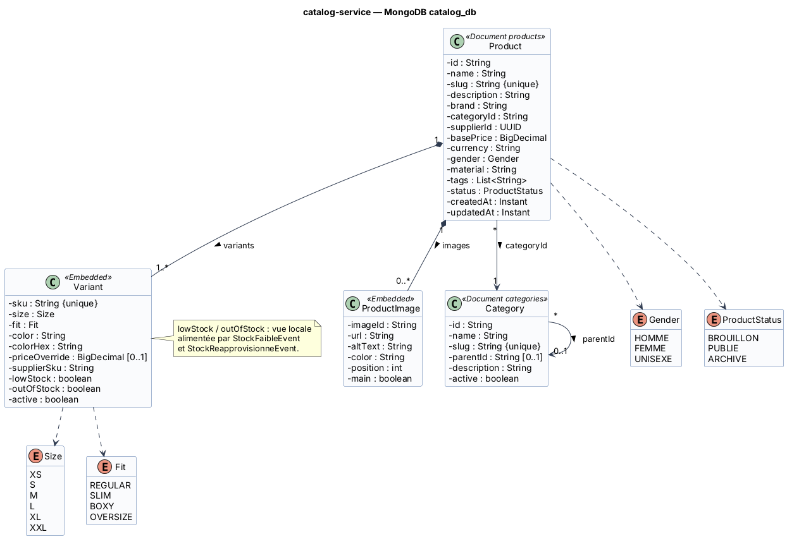

# Fiche 1 — Catalog Service (`catalog-service`)

| Élément | Valeur |
|---------|--------|
| Nom technique | `catalog-service` (port 8082) |
| Contexte borné | Catalogue (support) |
| Base | MongoDB `catalog_db` (conteneur `catalog-db`) |
| Routes Gateway | `/api/catalog/**` |
| Endpoints internes | `/internal/catalog/**` |
| Responsable | **Eya Frikha** |

## 1. Responsabilités

**Fait :**
- Gestion des **produits** (nom, description, marque, matière, genre, prix de base, fournisseur, statut de publication).
- Gestion des **variantes** : une variante = un **SKU** = taille × coupe (*regular*, *slim*, *boxy*, *oversize*) × coloris, avec un prix spécifique optionnel.
- Gestion des **images** par produit et par coloris (URL, ordre, image principale).
- **Catégories** hiérarchiques (Hauts › T-shirts › Oversize).
- **Recherche et filtres** : texte, catégorie, taille, coupe, coloris, prix.
- Source de vérité du **prix** et du **fournisseur** d'un SKU (appelée par order-service).
- Affichage des badges « Stock faible » et « Épuisé », à partir des événements du stock.

**Ne fait pas :** les quantités en stock (inventory-service) ni les prix figés d'une commande (order-service).

## 2. Entités et attributs

| Entité | Attributs principaux |
|--------|---------------------|
| `Product` (document `products`) | `id`, `name`, `slug` (unique), `description`, `brand`, `categoryId`, `supplierId`, `basePrice`, `currency`, `gender`, `material`, `tags[]`, `status`, `variants[]`, `images[]`, `createdAt`, `updatedAt` |
| `Variant` (imbriqué) | `sku` (unique, index), `size`, `fit`, `color`, `colorHex`, `priceOverride`, `supplierSku`, `lowStock`, `outOfStock`, `active` |
| `ProductImage` (imbriqué) | `imageId`, `url`, `altText`, `color`, `position`, `main` |
| `Category` (document `categories`) | `id`, `name`, `slug` (unique), `parentId`, `description`, `active` |
| Enums | `Size` (XS…XXL), `Fit` (REGULAR, SLIM, BOXY, OVERSIZE), `Gender` (HOMME, FEMME, UNISEXE), `ProductStatus` (BROUILLON, PUBLIE, ARCHIVE) |

<!-- BEGIN puml:classes-catalog-service -->


<details>
<summary>Code PlantUML — <code>../Diagrams/src/classes-catalog-service.puml</code></summary>

```plantuml
@startuml classes-catalog-service
!include _style.iuml
title catalog-service — MongoDB catalog_db

class Product <<Document products>> {
  - id : String
  - name : String
  - slug : String {unique}
  - description : String
  - brand : String
  - categoryId : String
  - supplierId : UUID
  - basePrice : BigDecimal
  - currency : String
  - gender : Gender
  - material : String
  - tags : List<String>
  - status : ProductStatus
  - createdAt : Instant
  - updatedAt : Instant
}
class Variant <<Embedded>> {
  - sku : String {unique}
  - size : Size
  - fit : Fit
  - color : String
  - colorHex : String
  - priceOverride : BigDecimal [0..1]
  - supplierSku : String
  - lowStock : boolean
  - outOfStock : boolean
  - active : boolean
}
class ProductImage <<Embedded>> {
  - imageId : String
  - url : String
  - altText : String
  - color : String
  - position : int
  - main : boolean
}
class Category <<Document categories>> {
  - id : String
  - name : String
  - slug : String {unique}
  - parentId : String [0..1]
  - description : String
  - active : boolean
}
enum Size {
  XS
  S
  M
  L
  XL
  XXL
}
enum Fit {
  REGULAR
  SLIM
  BOXY
  OVERSIZE
}
enum Gender {
  HOMME
  FEMME
  UNISEXE
}
enum ProductStatus {
  BROUILLON
  PUBLIE
  ARCHIVE
}
Product "1" *-- "1..*" Variant : variants >
Product "1" *-- "0..*" ProductImage : images >
Product "*" --> "1" Category : categoryId >
Category "*" --> "0..1" Category : parentId >
Variant ..> Size
Variant ..> Fit
Product ..> Gender
Product ..> ProductStatus
note right of Variant
  lowStock / outOfStock : vue locale
  alimentée par StockFaibleEvent
  et StockReapprovisionneEvent.
end note
@enduml
```

</details>
<!-- END puml:classes-catalog-service -->

## 3. Choix de la base : MongoDB

- **Document auto-portant** : la fiche produit (variantes et images comprises) est lue en **une seule requête**, sans jointure. C'est le cas d'usage dominant.
- **Schéma flexible** : un jean (tour de taille, longueur) et un t-shirt (coupe boxy ou oversize) n'ont pas les mêmes attributs.
- Charge **majoritairement en lecture** : MongoDB se réplique et se répartit (*sharding*) facilement.
- **Index** : unique sur `variants.sku` et `slug`, index texte sur `name` et `description`, index composé `categoryId + status`.

## 4. Contrat d'API REST

| Ressource | URI | Méthode | Rôle | Corps / réponse | Codes |
|-----------|-----|---------|------|-----------------|-------|
| Produits | `/api/catalog/products?q=&categoryId=&sizes=M,L&fits=OVERSIZE&colors=noir&minPrice=&maxPrice=&page=&size=` | GET | public | → `Page<ProductSummaryDto>` | 200, 400 |
| Produit | `/api/catalog/products/{productId}` | GET | public | → `ProductDto` (variantes et images) | 200, 404 |
| Produits | `/api/catalog/products` | POST | ADMIN | `ProductRequest` → `ProductDto` + `Location` | 201, 400, 409 (slug existant) |
| Produit | `/api/catalog/products/{productId}` | PUT | ADMIN | `ProductRequest` → `ProductDto` | 200, 400, 404 |
| Statut | `/api/catalog/products/{productId}/status` | PATCH | ADMIN | `{status: PUBLIE \| ARCHIVE}` → `ProductDto` | 200, 400, 404 |
| Produit | `/api/catalog/products/{productId}` | DELETE | ADMIN | – (archivage logique) | 204, 404 |
| Variantes | `/api/catalog/products/{productId}/variants` | POST | ADMIN | `VariantRequest {sku, size, fit, color, colorHex, priceOverride, supplierSku}` → `VariantDto` | 201, 400, 404, 409 (SKU existant) |
| Variante | `/api/catalog/products/{productId}/variants/{sku}` | PUT | ADMIN | `VariantRequest` → `VariantDto` | 200, 400, 404 |
| Variante | `/api/catalog/products/{productId}/variants/{sku}` | DELETE | ADMIN | – (désactivation) | 204, 404 |
| Images | `/api/catalog/products/{productId}/images` | POST | ADMIN | `{url, altText, color, position, main}` → `ProductImageDto` | 201, 400, 404 |
| Image | `/api/catalog/products/{productId}/images/{imageId}` | DELETE | ADMIN | – | 204, 404 |
| Catégories | `/api/catalog/categories` | GET | public | → `CategoryDto[]` (arbre) | 200 |
| Catégories | `/api/catalog/categories` | POST | ADMIN | `CategoryRequest` → `CategoryDto` | 201, 400, 409 |
| Catégorie | `/api/catalog/categories/{categoryId}` | PUT | ADMIN | `CategoryRequest` → `CategoryDto` | 200, 400, 404 |
| Variante (interne) | `/internal/catalog/variants/{sku}` | GET | SERVICE | → `{sku, productId, productName, size, fit, color, unitPrice, currency, supplierId, active}` | 200, 404 |

## 5. Événements

| Sens | Événement / topic | Contenu | Rôle |
|------|-------------------|---------|------|
| Publié | **E1** `VarianteCreeeEvent` / `catalogue.variante-creee` | `{eventId, productId, sku, supplierId, size, fit, color, occurredAt}` | Inventory crée la ligne de stock (quantité 0, seuil par défaut). |
| Consommé | **E4** `StockFaibleEvent` / `stock.faible` | `{eventId, sku, productId, available, threshold}` | Met `lowStock = true` (et `outOfStock = true` si `available = 0`). |
| Consommé | **E5** `StockReapprovisionneEvent` / `stock.reapprovisionne` | `{eventId, sku, productId, available}` | Remet `lowStock` et `outOfStock` à `false`. |

## 6. Interactions et comportement en cas de panne

| Interaction | Mode | Données | En cas de panne |
|-------------|------|---------|-----------------|
| **S1** order-service → catalog-service `GET /internal/catalog/variants/{sku}` | Synchrone (appelé) | prix, nom, taille, coloris, fournisseur | Côté order : retry ×2, circuit breaker, puis **503** : l'article n'est pas ajouté au panier. Le prix ne doit jamais venir du front. |
| **E1** catalog → inventory | Asynchrone (produit) | nouveau SKU | Kafka indisponible : l'événement reste dans l'**outbox** et part au retour du broker. Le SKU est invendable tant que le stock n'existe pas (pas de survente possible). |
| **E4 / E5** inventory → catalog | Asynchrone (consommé) | niveau de stock | Si catalog est arrêté, les messages attendent dans Kafka (rétention). Au redémarrage, le service reprend à son *offset*. Seul le badge est temporairement en retard, l'achat reste protégé par la réservation. |

**Si catalog-service tombe :** le catalogue n'est plus consultable et l'ajout au panier est refusé (503). Les commandes déjà validées, les expéditions, les retours et les tickets continuent de fonctionner, car ils ne dépendent pas du catalogue à l'exécution.
