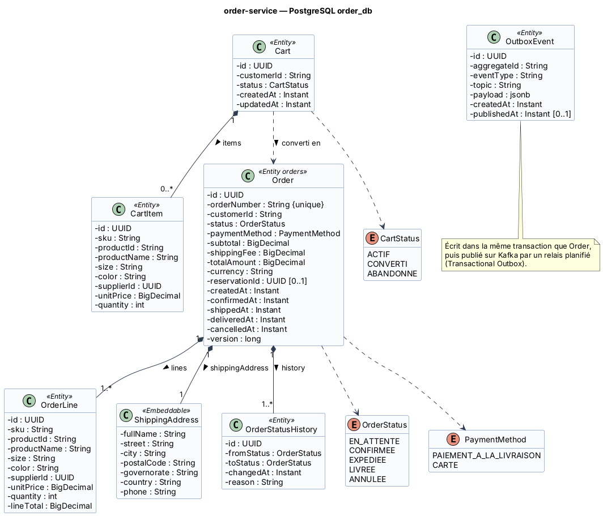

# Fiche 2 — Order Service (`order-service`)

| Élément | Valeur |
|---------|--------|
| Nom technique | `order-service` (port 8083) |
| Contexte borné | Prise de commande (cœur de métier) |
| Base | PostgreSQL `order_db` (conteneur `order-db`) |
| Routes Gateway | `/api/cart/**`, `/api/orders/**` |
| Endpoints internes | `/internal/orders/**` |
| Responsable | **Youssef Jaouani** |

## 1. Responsabilités

**Fait :**
- **Panier** : ajout, modification et suppression d'articles. Le prix et le fournisseur sont relus auprès du catalogue (S1) et figés dans la ligne.
- **Calcul du total** : sous-total, frais de livraison, total (TND).
- **Création de la commande** depuis le panier (statut `EN_ATTENTE`), avec l'adresse de livraison figée.
- **Validation** : réservation synchrone du stock (S2), passage à `CONFIRMEE`, publication de `CommandeValideeEvent`.
- **Cycle de vie** : `EN_ATTENTE → CONFIRMEE → EXPEDIEE → LIVREE`, et annulation (`ANNULEE`) avant expédition. Historique des statuts.
- Fourniture du détail d'une commande aux autres services (`/internal/orders/{orderId}`).

**Ne fait pas :** la gestion du stock, l'expédition, la facturation ni les retours.

### Cycle de vie de la commande

```
EN_ATTENTE --validate (S2 OK)--> CONFIRMEE --E6 CommandeExpedieeEvent--> EXPEDIEE --E7 CommandeLivreeEvent--> LIVREE
EN_ATTENTE --cancel--> ANNULEE
CONFIRMEE  --cancel (avant expédition)--> ANNULEE  (publie E3 CommandeAnnuleeEvent)
```

## 2. Entités et attributs

| Entité | Attributs principaux |
|--------|---------------------|
| `Cart` | `id`, `customerId`, `status` (ACTIF, CONVERTI, ABANDONNE), `items[]`, `createdAt`, `updatedAt` |
| `CartItem` | `id`, `sku`, `productId`, `productName`, `size`, `color`, `supplierId`, `unitPrice` (figé), `quantity` |
| `Order` (table `orders`) | `id`, `orderNumber` (unique, ex. `DW-2026-000123`), `customerId`, `status`, `paymentMethod`, `subtotal`, `shippingFee`, `totalAmount`, `currency`, `reservationId`, `shippingAddress`, dates (`createdAt`, `confirmedAt`, `shippedAt`, `deliveredAt`, `cancelledAt`), `version` |
| `OrderLine` | `id`, `sku`, `productId`, `productName`, `size`, `color`, `supplierId`, `unitPrice`, `quantity`, `lineTotal` |
| `ShippingAddress` (embarqué) | `fullName`, `street`, `city`, `postalCode`, `governorate`, `country`, `phone` |
| `OrderStatusHistory` | `id`, `fromStatus`, `toStatus`, `changedAt`, `reason` |
| `OutboxEvent` | `id`, `aggregateId`, `eventType`, `topic`, `payload` (jsonb), `createdAt`, `publishedAt` |
| Enums | `OrderStatus` (EN_ATTENTE, CONFIRMEE, EXPEDIEE, LIVREE, ANNULEE), `PaymentMethod` (PAIEMENT_A_LA_LIVRAISON, CARTE), `CartStatus` |

<!-- BEGIN puml:classes-order-service -->


<details>
<summary>Code PlantUML — <code>../Diagrams/src/classes-order-service.puml</code></summary>

```plantuml
@startuml classes-order-service
!include _style.iuml
title order-service — PostgreSQL order_db

class Cart <<Entity>> {
  - id : UUID
  - customerId : String
  - status : CartStatus
  - createdAt : Instant
  - updatedAt : Instant
}
class CartItem <<Entity>> {
  - id : UUID
  - sku : String
  - productId : String
  - productName : String
  - size : String
  - color : String
  - supplierId : UUID
  - unitPrice : BigDecimal
  - quantity : int
}
class Order <<Entity orders>> {
  - id : UUID
  - orderNumber : String {unique}
  - customerId : String
  - status : OrderStatus
  - paymentMethod : PaymentMethod
  - subtotal : BigDecimal
  - shippingFee : BigDecimal
  - totalAmount : BigDecimal
  - currency : String
  - reservationId : UUID [0..1]
  - createdAt : Instant
  - confirmedAt : Instant
  - shippedAt : Instant
  - deliveredAt : Instant
  - cancelledAt : Instant
  - version : long
}
class OrderLine <<Entity>> {
  - id : UUID
  - sku : String
  - productId : String
  - productName : String
  - size : String
  - color : String
  - supplierId : UUID
  - unitPrice : BigDecimal
  - quantity : int
  - lineTotal : BigDecimal
}
class ShippingAddress <<Embeddable>> {
  - fullName : String
  - street : String
  - city : String
  - postalCode : String
  - governorate : String
  - country : String
  - phone : String
}
class OrderStatusHistory <<Entity>> {
  - id : UUID
  - fromStatus : OrderStatus
  - toStatus : OrderStatus
  - changedAt : Instant
  - reason : String
}
class OutboxEvent <<Entity>> {
  - id : UUID
  - aggregateId : String
  - eventType : String
  - topic : String
  - payload : jsonb
  - createdAt : Instant
  - publishedAt : Instant [0..1]
}
enum OrderStatus {
  EN_ATTENTE
  CONFIRMEE
  EXPEDIEE
  LIVREE
  ANNULEE
}
enum PaymentMethod {
  PAIEMENT_A_LA_LIVRAISON
  CARTE
}
enum CartStatus {
  ACTIF
  CONVERTI
  ABANDONNE
}
Cart "1" *-- "0..*" CartItem : items >
Order "1" *-- "1..*" OrderLine : lines >
Order "1" *-- "1" ShippingAddress : shippingAddress >
Order "1" *-- "1..*" OrderStatusHistory : history >
Order ..> OrderStatus
Order ..> PaymentMethod
Cart ..> CartStatus
Cart ..> Order : converti en >
note bottom of OutboxEvent
  Écrit dans la même transaction que Order,
  puis publié sur Kafka par un relais planifié
  (Transactional Outbox).
end note
@enduml
```

</details>
<!-- END puml:classes-order-service -->

## 3. Choix de la base : PostgreSQL

- **Transactions ACID** : commande, lignes, historique et événement outbox sont écrits dans **une seule transaction**. C'est la condition du pattern *Transactional Outbox*.
- **Verrou optimiste** (`@Version`) contre les transitions concurrentes (ex. annulation pendant la validation).
- Requêtes analytiques simples pour l'admin (par statut, par période) et type `jsonb` pour le contenu de l'outbox.
- Montants en `NUMERIC(12,3)` (le dinar compte 3 décimales).

## 4. Contrat d'API REST

| Ressource | URI | Méthode | Rôle | Corps / réponse | Codes |
|-----------|-----|---------|------|-----------------|-------|
| Panier | `/api/cart` | GET | CLIENT | → `CartDto {items[], subtotal}` (créé s'il n'existe pas) | 200, 401 |
| Articles | `/api/cart/items` | POST | CLIENT | `{sku, quantity}` → `CartDto` | 201, 400, 404 (SKU inconnu), 503 (catalogue indisponible) |
| Article | `/api/cart/items/{itemId}` | PATCH | CLIENT | `{quantity}` → `CartDto` | 200, 400, 404 |
| Article | `/api/cart/items/{itemId}` | DELETE | CLIENT | – | 204, 404 |
| Panier | `/api/cart` | DELETE | CLIENT | – (vider) | 204 |
| Commandes | `/api/orders` | POST | CLIENT | `{shippingAddress{…}, paymentMethod}` → `OrderDto (EN_ATTENTE)` + `Location` | 201, 400 (panier vide ou adresse invalide) |
| Validation | `/api/orders/{orderId}/validate` | POST | CLIENT (propriétaire) | – → `OrderDto (CONFIRMEE)` | 200, 403, 404, 409 (stock insuffisant `{unavailableSkus[]}` ou statut invalide), 503 (inventory indisponible) |
| Annulation | `/api/orders/{orderId}/cancel` | POST | CLIENT (propriétaire), ADMIN | `{reason}` → `OrderDto (ANNULEE)` | 200, 403, 404, 409 (déjà expédiée) |
| Mes commandes | `/api/orders/me?status=&page=&size=` | GET | CLIENT | → `Page<OrderSummaryDto>` | 200 |
| Commande | `/api/orders/{orderId}` | GET | CLIENT (propriétaire), ADMIN, SUPPORT | → `OrderDto` | 200, 403, 404 |
| Historique | `/api/orders/{orderId}/history` | GET | CLIENT (propriétaire), ADMIN, SUPPORT | → `OrderStatusHistoryDto[]` | 200, 404 |
| Commandes | `/api/orders?status=&from=&to=&page=` | GET | ADMIN, SUPPORT | → `Page<OrderSummaryDto>` | 200, 403 |
| Commande (interne) | `/internal/orders/{orderId}` | GET | SERVICE | → `{orderId, orderNumber, customerId, status, deliveredAt, lines[{sku, productName, quantity, unitPrice}]}` | 200, 404 |

## 5. Événements

| Sens | Événement / topic | Contenu | Consommateurs ou effet |
|------|-------------------|---------|------------------------|
| Publié | **E2** `CommandeValideeEvent` / `commande.validee` (clé = `orderId`) | `{eventId, orderId, orderNumber, customerId, reservationId, paymentMethod, totalAmount, currency, shippingAddress{…}, lines[{sku, productId, productName, supplierId, quantity, unitPrice}], occurredAt}` | inventory (décrément définitif), fulfillment (facture, paiement, expéditions) |
| Publié | **E3** `CommandeAnnuleeEvent` / `commande.annulee` | `{eventId, orderId, reservationId, reason, occurredAt}` | inventory (libération ou réintégration), fulfillment (annulation des expéditions, avoir) |
| Consommé | **E6** `CommandeExpedieeEvent` / `livraison.expediee` | `{orderId, carrier, trackingNumber, shippedAt}` | statut `EXPEDIEE` |
| Consommé | **E7** `CommandeLivreeEvent` / `livraison.livree` | `{orderId, deliveredAt}` | statut `LIVREE` + `deliveredAt` (point de départ des 14 jours) |

L'événement E2 transporte **tout ce dont les consommateurs ont besoin** (*event-carried state transfer*). Fulfillment n'a donc jamais besoin de rappeler order-service.

## 6. Interactions et comportement en cas de panne

| Interaction | Mode | Données | En cas de panne |
|-------------|------|---------|-----------------|
| **S1** order → catalog `GET /internal/catalog/variants/{sku}` (ajout au panier) | OpenFeign | `sku` → prix, nom, fournisseur | Timeout 2 s, retry ×2 (GET idempotent), circuit breaker `catalog`. Fallback : **503**, l'article n'est pas ajouté. On ne fait pas confiance au prix envoyé par le front. |
| **S2** order → inventory `POST /internal/inventory/reservations` (validation) | OpenFeign | `{referenceType: COMMANDE, referenceId: orderId, lines[{sku, quantity}], ttlMinutes: 30}` + en-tête `Idempotency-Key: orderId` | Timeout 3 s, retry ×2 (sûr grâce à l'`Idempotency-Key`), circuit breaker `inventory`. Fallback : la commande **reste `EN_ATTENTE`**, réponse **503** « réessayez ». **Jamais de confirmation sans réservation**, sinon il y a un risque de survente. |
| **E2 / E3** order → Kafka | Asynchrone | voir ci-dessus | **Outbox** : si Kafka est indisponible, l'événement reste en base et le relais planifié réessaie. La commande est quand même `CONFIRMEE` pour le client. |
| **E6 / E7** Kafka → order | Asynchrone | statut | Consommateur idempotent (transition ignorée si déjà appliquée), 3 retries puis topic `*.DLT`. |
| **S3 / S5** return et ticketing → order `GET /internal/orders/{orderId}` | Appelé | détail de la commande | Si order tombe : return répond 503, ticketing crée le ticket en mode dégradé (`orderVerified = false`). |

**Si order-service tombe :** il n'est plus possible de commander, mais le catalogue, le suivi des colis (fulfillment), les tickets (mode dégradé) et la mise à jour du stock continuent. Les événements E6 et E7 s'accumulent dans Kafka et sont traités au redémarrage.
