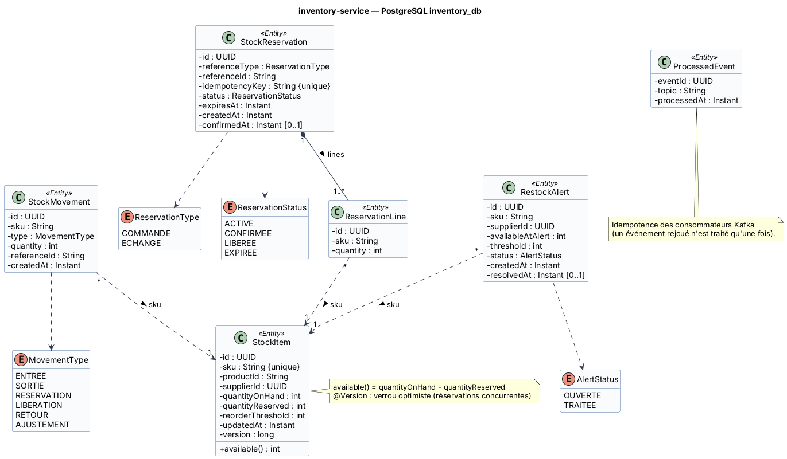

# Fiche 3 — Inventory Service (`inventory-service`)

| Élément | Valeur |
|---------|--------|
| Nom technique | `inventory-service` (port 8084) |
| Contexte borné | Stock (cœur de métier) |
| Base | PostgreSQL `inventory_db` (conteneur `inventory-db`). **Pas de Redis en V1** (voir §3) |
| Routes Gateway | `/api/inventory/stocks/**`, `/api/inventory/alerts/**`, `/api/inventory/movements/**` |
| Endpoints internes | `/internal/inventory/reservations/**` (**non routés** : un client ne peut pas réserver directement) |
| Responsable | **Yasser Chebbi** |

## 1. Responsabilités

**Fait :**
- **Stock par SKU** : quantité physique déclarée par le fournisseur (`quantityOnHand`), quantité réservée (`quantityReserved`), disponible calculé.
- **Verrouillage temporaire** (réservation) lors de la validation d'une commande ou d'un échange, avec une **expiration** (30 min pour une commande, 14 jours pour un échange).
- **Décrémentation définitive** à la réception de `CommandeValideeEvent`. **Libération** à l'annulation ou à l'expiration.
- **Réintégration** des articles retournés en bon état (`RetourRecuEvent`).
- **Alertes de réapprovisionnement** quand le disponible devient inférieur ou égal au seuil, visibles par l'admin et le fournisseur concerné.
- Journal des **mouvements** de stock (audit).

**Ne fait pas :** la description des produits, les prix, ni la commande auprès du fournisseur.

### Cycle d'une réservation

```
ACTIVE --CommandeValideeEvent / RetourRecuEvent (échange)--> CONFIRMEE   (onHand -= q ; reserved -= q)
ACTIVE --CommandeAnnuleeEvent ou DELETE--> LIBEREE                         (reserved -= q)
ACTIVE --expiresAt dépassé (job @Scheduled chaque minute)--> EXPIREE      (reserved -= q)
```

## 2. Entités et attributs

| Entité | Attributs principaux |
|--------|---------------------|
| `StockItem` | `id`, `sku` (unique), `productId`, `supplierId`, `quantityOnHand`, `quantityReserved`, `reorderThreshold`, `updatedAt`, `version` · `available() = onHand − reserved` |
| `StockReservation` | `id`, `referenceType` (COMMANDE, ECHANGE), `referenceId` (`orderId` ou `rmaNumber`), `idempotencyKey` (unique), `status`, `expiresAt`, `createdAt`, `confirmedAt`, `lines[]` |
| `ReservationLine` | `id`, `sku`, `quantity` |
| `StockMovement` | `id`, `sku`, `type` (ENTREE, SORTIE, RESERVATION, LIBERATION, RETOUR, AJUSTEMENT), `quantity`, `referenceId`, `createdAt` |
| `RestockAlert` | `id`, `sku`, `supplierId`, `availableAtAlert`, `threshold`, `status` (OUVERTE, TRAITEE), `createdAt`, `resolvedAt` |
| `ProcessedEvent` | `eventId`, `topic`, `processedAt` (idempotence des consommateurs) |

<!-- BEGIN puml:classes-inventory-service -->


<details>
<summary>Code PlantUML — <code>../Diagrams/src/classes-inventory-service.puml</code></summary>

```plantuml
@startuml classes-inventory-service
!include _style.iuml
title inventory-service — PostgreSQL inventory_db

class StockItem <<Entity>> {
  - id : UUID
  - sku : String {unique}
  - productId : String
  - supplierId : UUID
  - quantityOnHand : int
  - quantityReserved : int
  - reorderThreshold : int
  - updatedAt : Instant
  - version : long
  + available() : int
}
class StockReservation <<Entity>> {
  - id : UUID
  - referenceType : ReservationType
  - referenceId : String
  - idempotencyKey : String {unique}
  - status : ReservationStatus
  - expiresAt : Instant
  - createdAt : Instant
  - confirmedAt : Instant [0..1]
}
class ReservationLine <<Entity>> {
  - id : UUID
  - sku : String
  - quantity : int
}
class StockMovement <<Entity>> {
  - id : UUID
  - sku : String
  - type : MovementType
  - quantity : int
  - referenceId : String
  - createdAt : Instant
}
class RestockAlert <<Entity>> {
  - id : UUID
  - sku : String
  - supplierId : UUID
  - availableAtAlert : int
  - threshold : int
  - status : AlertStatus
  - createdAt : Instant
  - resolvedAt : Instant [0..1]
}
class ProcessedEvent <<Entity>> {
  - eventId : UUID
  - topic : String
  - processedAt : Instant
}
enum ReservationType {
  COMMANDE
  ECHANGE
}
enum ReservationStatus {
  ACTIVE
  CONFIRMEE
  LIBEREE
  EXPIREE
}
enum MovementType {
  ENTREE
  SORTIE
  RESERVATION
  LIBERATION
  RETOUR
  AJUSTEMENT
}
enum AlertStatus {
  OUVERTE
  TRAITEE
}
StockReservation "1" *-- "1..*" ReservationLine : lines >
ReservationLine "*" ..> "1" StockItem : sku >
StockMovement "*" ..> "1" StockItem : sku >
RestockAlert "*" ..> "1" StockItem : sku >
StockReservation ..> ReservationType
StockReservation ..> ReservationStatus
StockMovement ..> MovementType
RestockAlert ..> AlertStatus
note right of StockItem
  available() = quantityOnHand - quantityReserved
  @Version : verrou optimiste (réservations concurrentes)
end note
note bottom of ProcessedEvent
  Idempotence des consommateurs Kafka
  (un événement rejoué n'est traité qu'une fois).
end note
@enduml
```

</details>
<!-- END puml:classes-inventory-service -->

## 3. Choix de la base : PostgreSQL seul (Redis écarté en V1)

**Pourquoi PostgreSQL :**
- Le cœur du service est une **section critique concurrente** : deux clients réservent la dernière pièce en même temps. PostgreSQL apporte :
  - le **verrou de ligne** (`SELECT … FOR UPDATE`) ou le **verrou optimiste** (`@Version` : le perdant reçoit une `OptimisticLockException` et l'appel est rejoué) ;
  - l'**atomicité** : créer la réservation et incrémenter `quantityReserved` dans une seule transaction ;
  - des **contraintes** de garde : `CHECK (quantity_reserved <= quantity_on_hand)`, `UNIQUE (idempotency_key)`.
- L'expiration des réservations se fait avec une colonne `expires_at` (indexée) et un job `@Scheduled(fixedRate = 60 s)`.

**Pourquoi pas Redis (en V1) :**
- Redis **n'est pas dans la stack imposée** (H2, MySQL, MongoDB, PostgreSQL).
- Deux stockages (Redis pour les verrous, PostgreSQL pour le stock) = **deux sources de vérité à synchroniser** et un risque d'incohérence si l'un des deux tombe entre deux écritures.
- Le volume d'un projet étudiant (et même d'une boutique moyenne) ne justifie pas un cache distribué.

**Quand Redis deviendrait pertinent (perspective) :** des pics de lecture des disponibilités (soldes) → cache de lecture *cache-aside* devant `GET /api/inventory/stocks`. Ou des milliers de réservations par seconde → TTL natif (`SET sku:lock NX EX 1800`). PostgreSQL resterait la source de vérité.

## 4. Contrat d'API REST

| Ressource | URI | Méthode | Rôle | Corps / réponse | Codes |
|-----------|-----|---------|------|-----------------|-------|
| Stock d'un SKU | `/api/inventory/stocks/{sku}` | GET | public | → `{sku, available, inStock}` | 200, 404 |
| Stocks (lot) | `/api/inventory/stocks?skus=SKU1,SKU2` | GET | public | → `StockDto[]` (disponibilité affichée sur la fiche produit) | 200, 400 |
| Mes stocks | `/api/inventory/stocks/mine` | GET | FOURNISSEUR | → `StockItemDto[]` (ses SKU) | 200, 403 |
| Mise à jour du stock | `/api/inventory/stocks/{sku}` | PUT | FOURNISSEUR (propriétaire du SKU), ADMIN | `{quantityOnHand}` → `StockItemDto` | 200, 400, 403, 404, 409 (inférieur à la quantité réservée) |
| Seuil | `/api/inventory/stocks/{sku}/threshold` | PATCH | ADMIN | `{reorderThreshold}` → `StockItemDto` | 200, 400, 404 |
| Alertes | `/api/inventory/alerts?status=OUVERTE` | GET | ADMIN, FOURNISSEUR (les siennes) | → `RestockAlertDto[]` | 200, 403 |
| Alerte | `/api/inventory/alerts/{alertId}` | PATCH | ADMIN, FOURNISSEUR | `{status: TRAITEE}` → `RestockAlertDto` | 200, 404 |
| Mouvements | `/api/inventory/movements?sku=&from=&to=` | GET | ADMIN | → `Page<StockMovementDto>` | 200 |
| Réservation (interne) | `/internal/inventory/reservations` | POST | SERVICE | en-tête `Idempotency-Key` · `{referenceType, referenceId, lines[{sku, quantity}], ttlMinutes}` → `{reservationId, status: ACTIVE, expiresAt}` | 201, 200 (rejeu idempotent), 400, 409 `{unavailableSkus[]}` |
| Réservation (interne) | `/internal/inventory/reservations/{reservationId}` | GET | SERVICE | → `ReservationDto` | 200, 404 |
| Réservation (interne) | `/internal/inventory/reservations/{reservationId}` | DELETE | SERVICE | – (libération explicite) | 204, 404, 409 (déjà confirmée) |

## 5. Événements

| Sens | Événement / topic | Contenu | Effet |
|------|-------------------|---------|-------|
| Consommé | **E1** `VarianteCreeeEvent` / `catalogue.variante-creee` | `{productId, sku, supplierId}` | Crée le `StockItem` (onHand 0, seuil par défaut 5) |
| Consommé | **E2** `CommandeValideeEvent` / `commande.validee` | `{orderId, reservationId, lines[]}` | Réservation → `CONFIRMEE`, `onHand -= q`, `reserved -= q`, mouvement `SORTIE` |
| Consommé | **E3** `CommandeAnnuleeEvent` / `commande.annulee` | `{orderId, reservationId}` | Réservation active → `LIBEREE`. Réservation déjà confirmée → réintégration (`ENTREE`) |
| Consommé | **E10** `RetourRecuEvent` / `retour.recu` | `{rmaNumber, type, items[{sku, quantity, condition, replacementSku, replacementReservationId}]}` | Articles `REVENDABLE` : `onHand += q` (mouvement `RETOUR`). Échange : réservation de remplacement → `CONFIRMEE` |
| Publié | **E4** `StockFaibleEvent` / `stock.faible` | `{eventId, sku, productId, supplierId, available, threshold}` | Catalog affiche le badge. Une `RestockAlert` est créée |
| Publié | **E5** `StockReapprovisionneEvent` / `stock.reapprovisionne` | `{eventId, sku, productId, available}` | Catalog retire le badge. L'alerte passe à `TRAITEE` |

## 6. Interactions et comportement en cas de panne

| Interaction | Mode | Données | En cas de panne |
|-------------|------|---------|-----------------|
| **S2** order → inventory (réservation de la commande) | Synchrone (appelé) | lignes de commande → `reservationId` | Si inventory tombe, order répond 503 et la commande reste `EN_ATTENTE` : **aucune vente sans stock vérifié**. |
| **S4** return → inventory (réservation de l'échange) | Synchrone (appelé) | SKU de remplacement → `reservationId` | Si inventory tombe, return propose un **remboursement** à la place de l'échange. |
| **E2** reçu en retard (inventory arrêté plus de 30 min) | Asynchrone | – | La réservation a pu expirer. Le consommateur applique quand même la décrémentation (la commande est vendue) et crée une alerte si le stock devient négatif. Mitigation : TTL 30 min > durée de reprise visée, et rétention Kafka de 7 jours. |
| Événements reçus deux fois | Asynchrone | – | Idempotence par `ProcessedEvent(eventId)`. Un E2 rejoué ne décrémente pas deux fois. |
| Erreur de traitement | Asynchrone | – | 3 retries (backoff 1 s, 2 s, 4 s), puis topic `commande.validee.DLT` pour une analyse manuelle. |

**Si inventory-service tombe :** les nouvelles validations de commande et d'échange sont refusées proprement (503). Le catalogue reste consultable (badges figés), les expéditions et la facturation continuent. Les événements s'accumulent dans Kafka et sont rejoués au redémarrage.
