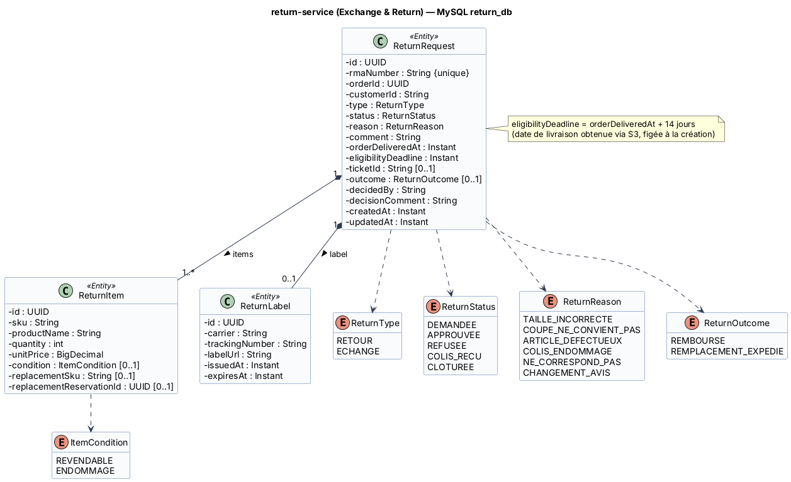

# Fiche 4 — Exchange & Return Service (`return-service`)

| Élément | Valeur |
|---------|--------|
| Nom technique | `return-service` (port 8085) |
| Contexte borné | Après-vente (cœur de métier) |
| Base | MySQL `return_db` (conteneur `return-db`) |
| Routes Gateway | `/api/returns/**` |
| Responsable | **Aziz Arfaouii** |

## 1. Responsabilités

**Fait :**
- **Workflow RMA** (*Return Merchandise Authorization*) : demande, décision, étiquette, réception, clôture.
- **Éligibilité** : la commande doit être `LIVREE` et la demande arriver au plus tard **14 jours** après la livraison. Les articles doivent appartenir à la commande et ne pas être déjà retournés.
- **Étiquette de retour** : numéro de suivi et URL du PDF (transporteur simulé), générés à l'approbation.
- **Échange de taille ou de coloris** : réservation immédiate du SKU de remplacement (S4).
- Saisie de l'**état des articles reçus** (revendable ou endommagé).
- Lien optionnel avec un **ticket support** (`ticketId`), par exemple pour un colis endommagé.

**Ne fait pas :** le remboursement ni l'envoi du remplacement (fulfillment-service), la remise en stock (inventory-service).

### Cycle de vie d'une RMA

```
DEMANDEE --approve--> APPROUVEE (étiquette émise, E9) --receive--> COLIS_RECU (E10) --E11 RetourFinaliseEvent--> CLOTUREE
DEMANDEE --reject--> REFUSEE   (la réservation d'échange est libérée)
```

## 2. Entités et attributs

| Entité | Attributs principaux |
|--------|---------------------|
| `ReturnRequest` | `id`, `rmaNumber` (unique, ex. `RMA-2026-000045`), `orderId`, `customerId`, `type` (RETOUR, ECHANGE), `status`, `reason`, `comment`, `orderDeliveredAt`, `eligibilityDeadline`, `ticketId`, `outcome` (REMBOURSE, REMPLACEMENT_EXPEDIE), `decidedBy`, `decisionComment`, `createdAt`, `updatedAt` |
| `ReturnItem` | `id`, `sku`, `productName`, `quantity`, `unitPrice`, `condition` (REVENDABLE, ENDOMMAGE), `replacementSku`, `replacementReservationId` |
| `ReturnLabel` | `id`, `carrier`, `trackingNumber`, `labelUrl`, `issuedAt`, `expiresAt` |
| Enums | `ReturnType`, `ReturnStatus` (DEMANDEE, APPROUVEE, REFUSEE, COLIS_RECU, CLOTUREE), `ReturnReason` (TAILLE_INCORRECTE, COUPE_NE_CONVIENT_PAS, ARTICLE_DEFECTUEUX, COLIS_ENDOMMAGE, NE_CORRESPOND_PAS, CHANGEMENT_AVIS), `ItemCondition`, `ReturnOutcome` |

<!-- BEGIN puml:classes-return-service -->


<details>
<summary>Code PlantUML — <code>../Diagrams/src/classes-return-service.puml</code></summary>

```plantuml
@startuml classes-return-service
!include _style.iuml
title return-service (Exchange & Return) — MySQL return_db

class ReturnRequest <<Entity>> {
  - id : UUID
  - rmaNumber : String {unique}
  - orderId : UUID
  - customerId : String
  - type : ReturnType
  - status : ReturnStatus
  - reason : ReturnReason
  - comment : String
  - orderDeliveredAt : Instant
  - eligibilityDeadline : Instant
  - ticketId : String [0..1]
  - outcome : ReturnOutcome [0..1]
  - decidedBy : String
  - decisionComment : String
  - createdAt : Instant
  - updatedAt : Instant
}
class ReturnItem <<Entity>> {
  - id : UUID
  - sku : String
  - productName : String
  - quantity : int
  - unitPrice : BigDecimal
  - condition : ItemCondition [0..1]
  - replacementSku : String [0..1]
  - replacementReservationId : UUID [0..1]
}
class ReturnLabel <<Entity>> {
  - id : UUID
  - carrier : String
  - trackingNumber : String
  - labelUrl : String
  - issuedAt : Instant
  - expiresAt : Instant
}
enum ReturnType {
  RETOUR
  ECHANGE
}
enum ReturnStatus {
  DEMANDEE
  APPROUVEE
  REFUSEE
  COLIS_RECU
  CLOTUREE
}
enum ReturnReason {
  TAILLE_INCORRECTE
  COUPE_NE_CONVIENT_PAS
  ARTICLE_DEFECTUEUX
  COLIS_ENDOMMAGE
  NE_CORRESPOND_PAS
  CHANGEMENT_AVIS
}
enum ItemCondition {
  REVENDABLE
  ENDOMMAGE
}
enum ReturnOutcome {
  REMBOURSE
  REMPLACEMENT_EXPEDIE
}
ReturnRequest "1" *-- "1..*" ReturnItem : items >
ReturnRequest "1" *-- "0..1" ReturnLabel : label >
ReturnRequest ..> ReturnType
ReturnRequest ..> ReturnStatus
ReturnRequest ..> ReturnReason
ReturnRequest ..> ReturnOutcome
ReturnItem ..> ItemCondition
note right of ReturnRequest
  eligibilityDeadline = orderDeliveredAt + 14 jours
  (date de livraison obtenue via S3, figée à la création)
end note
@enduml
```

</details>
<!-- END puml:classes-return-service -->

## 3. Choix de la base : MySQL

- **Workflow très structuré** : une RMA, ses articles et son étiquette, avec des contraintes d'intégrité (clés étrangères, unicité de `rmaNumber`, unicité d'une RMA active par `orderId + sku`).
- Requêtes de back-office : file des RMA par statut et par date, délais de traitement.
- Transactions ACID sur les transitions d'état.
- **MySQL** plutôt que PostgreSQL : les deux conviennent. Le choix diversifie la stack et montre que chaque équipe choisit sa technologie (*polyglot persistence*) sans impact sur les autres services.

## 4. Contrat d'API REST

| Ressource | URI | Méthode | Rôle | Corps / réponse | Codes |
|-----------|-----|---------|------|-----------------|-------|
| Éligibilité | `/api/returns/eligibility?orderId={orderId}` | GET | CLIENT (propriétaire) | → `{eligible, deadline, eligibleItems[{sku, productName, quantity}], reason}` | 200, 403, 404, 503 |
| Demandes | `/api/returns` | POST | CLIENT | `{orderId, type, reason, comment, ticketId?, items[{sku, quantity, replacementSku?}]}` → `ReturnDto (DEMANDEE)` + `Location` | 201, 400, 403, 404, 409 (RMA déjà active ou taille de remplacement indisponible), 422 (hors délai ou commande non livrée), 503 |
| Mes demandes | `/api/returns/me` | GET | CLIENT | → `ReturnSummaryDto[]` | 200 |
| Demande | `/api/returns/{rmaId}` | GET | CLIENT (propriétaire), ADMIN, SUPPORT | → `ReturnDto` | 200, 403, 404 |
| File de traitement | `/api/returns?status=&type=&page=` | GET | ADMIN, SUPPORT | → `Page<ReturnSummaryDto>` | 200, 403 |
| Approbation | `/api/returns/{rmaId}/approve` | POST | ADMIN, SUPPORT | `{comment}` → `ReturnDto (APPROUVEE + label)` | 200, 404, 409 (statut invalide) |
| Refus | `/api/returns/{rmaId}/reject` | POST | ADMIN, SUPPORT | `{reason}` → `ReturnDto (REFUSEE)` | 200, 400, 404, 409 |
| Étiquette | `/api/returns/{rmaId}/label` | GET | CLIENT (propriétaire), ADMIN | → `{carrier, trackingNumber, labelUrl}` | 200, 403, 404 (pas encore émise) |
| Réception | `/api/returns/{rmaId}/receive` | POST | ADMIN, FOURNISSEUR | `{items[{sku, condition}]}` → `ReturnDto (COLIS_RECU)` | 200, 400, 404, 409 |

## 5. Événements

| Sens | Événement / topic | Contenu | Consommateurs ou effet |
|------|-------------------|---------|------------------------|
| Publié | **E9** `RetourApprouveEvent` / `retour.approuve` | `{eventId, rmaId, rmaNumber, orderId, customerId, type, ticketId, trackingNumber}` | ticketing (si `ticketId` : message système et ticket `RESOLU`) |
| Publié | **E10** `RetourRecuEvent` / `retour.recu` | `{eventId, rmaId, rmaNumber, orderId, customerId, type, items[{sku, quantity, unitPrice, condition, replacementSku, replacementReservationId}], refundAmount}` | inventory (remise en stock, confirmation du remplacement), fulfillment (remboursement + avoir, ou expédition du remplacement) |
| Consommé | **E11** `RetourFinaliseEvent` / `retour.finalise` | `{rmaId, outcome, refundId?, shipmentId?, trackingNumber?}` | statut `CLOTUREE` + `outcome` |

## 6. Interactions et comportement en cas de panne

| Interaction | Mode | Données | En cas de panne |
|-------------|------|---------|-----------------|
| **S3** return → order `GET /internal/orders/{orderId}` | OpenFeign | → `customerId`, `status`, `deliveredAt`, `lines[]` | Timeout 2 s, retry ×2, circuit breaker `order`. Fallback : **503** « vérification impossible, réessayez ». **Aucune RMA créée sans vérification** (pas de décision sur des données incertaines). |
| **S4** return → inventory `POST /internal/inventory/reservations` (échange) | OpenFeign | `{referenceType: ECHANGE, referenceId: rmaNumber, lines[{replacementSku, quantity}], ttlMinutes: 20160}` | Timeout 3 s, retry ×2 (`Idempotency-Key = rmaNumber`), circuit breaker `inventory`. Fallback : **409** « taille indisponible pour le moment, un remboursement vous est proposé ». Le front propose de basculer en `RETOUR`. |
| **E9 / E10** return → Kafka | Asynchrone | voir ci-dessus | Outbox recommandée. Les événements sont publiés au retour du broker. |
| **E11** Kafka → return | Asynchrone | clôture | Consommateur idempotent. En cas d'arrêt, reprise à l'offset. |

**Si return-service tombe :** seules les demandes de retour sont indisponibles. Les commandes, la livraison et le support fonctionnent. Les remboursements déjà déclenchés (E10 publié) se poursuivent dans fulfillment.
