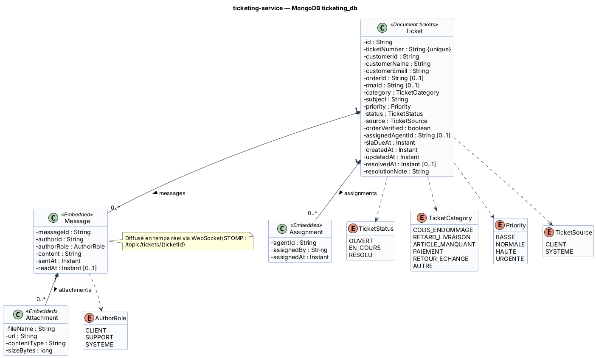

# Fiche 5 — Ticketing & Support Service (`ticketing-service`) · technologie avancée

| Élément | Valeur |
|---------|--------|
| Nom technique | `ticketing-service` (port 8086) |
| Contexte borné | Relation client (support) |
| Base | MongoDB `ticketing_db` (conteneur `ticketing-db`) |
| Routes Gateway | `/api/tickets/**` (HTTP) et `/ws/**` (WebSocket, route `ws://` ou `lb:ws://`) |
| Technologie avancée | **WebSocket + STOMP** (messagerie temps réel). À confirmer avec l'enseignant (voir P3 dans 00) |
| Responsable | **Med Houssaine** |

## 1. Responsabilités

**Fait :**
- **Tickets** : création par le client (colis endommagé, retard, article manquant, paiement, retour…) ou **automatiquement** par le système (retard de livraison détecté, `LivraisonRetardeeEvent`).
- **Messagerie** client ↔ agent sur un ticket, avec pièces jointes (URL), en **temps réel** via WebSocket/STOMP et persistée en base.
- **Assignation** à un agent (auto-assignation ou par l'admin), historique des assignations.
- **Statuts** : `OUVERT → EN_COURS → RESOLU`. Priorité et échéance SLA.
- **Contexte** : lien vers la commande (vérifié via S5) et vers la RMA (`rmaId`).

**Ne fait pas :** les décisions de retour (return-service) ni les remboursements (fulfillment-service).

## 2. Technologie avancée : WebSocket / STOMP

| Élément | Valeur |
|---------|--------|
| Endpoint de connexion | `/ws` (SockJS en repli) — le JWT est passé dans l'en-tête STOMP `CONNECT` (`Authorization: Bearer …`) et vérifié par un `ChannelInterceptor` |
| Abonnement | `SUBSCRIBE /topic/tickets/{ticketId}` (client propriétaire ou agent assigné uniquement) |
| Envoi | `SEND /app/tickets/{ticketId}/messages` `{content, attachments[]}` |
| Notifications agents | `SUBSCRIBE /topic/support/queue` (nouveau ticket, ticket automatique) |
| Persistance | Chaque message reçu est enregistré dans `Ticket.messages`, puis diffusé |
| Montée en charge (perspective) | Broker STOMP externe (*relay*) pour partager les sessions entre plusieurs instances |

**Pourquoi c'est « avancé » :** il s'agit d'une communication **bidirectionnelle et persistante**, très différente du modèle requête/réponse REST. Elle impose une authentification spécifique (JWT dans la trame `CONNECT`), un routage WebSocket dans la Gateway et la gestion des déconnexions.

## 3. Entités et attributs

| Entité | Attributs principaux |
|--------|---------------------|
| `Ticket` (document `tickets`) | `id`, `ticketNumber` (unique, ex. `TCK-2026-000210`), `customerId`, `customerName`, `customerEmail`, `orderId`, `rmaId`, `category`, `subject`, `priority`, `status`, `source` (CLIENT, SYSTEME), `orderVerified`, `assignedAgentId`, `slaDueAt`, `messages[]`, `assignments[]`, `createdAt`, `updatedAt`, `resolvedAt`, `resolutionNote` |
| `Message` (imbriqué) | `messageId`, `authorId`, `authorRole` (CLIENT, SUPPORT, SYSTEME), `content`, `attachments[]`, `sentAt`, `readAt` |
| `Attachment` (imbriqué) | `fileName`, `url`, `contentType`, `sizeBytes` |
| `Assignment` (imbriqué) | `agentId`, `assignedBy`, `assignedAt` |
| Enums | `TicketStatus` (OUVERT, EN_COURS, RESOLU), `TicketCategory` (COLIS_ENDOMMAGE, RETARD_LIVRAISON, ARTICLE_MANQUANT, PAIEMENT, RETOUR_ECHANGE, AUTRE), `Priority` (BASSE, NORMALE, HAUTE, URGENTE), `TicketSource`, `AuthorRole` |

<!-- BEGIN puml:classes-ticketing-service -->


<details>
<summary>Code PlantUML — <code>../Diagrams/src/classes-ticketing-service.puml</code></summary>

```plantuml
@startuml classes-ticketing-service
!include _style.iuml
title ticketing-service — MongoDB ticketing_db

class Ticket <<Document tickets>> {
  - id : String
  - ticketNumber : String {unique}
  - customerId : String
  - customerName : String
  - customerEmail : String
  - orderId : String [0..1]
  - rmaId : String [0..1]
  - category : TicketCategory
  - subject : String
  - priority : Priority
  - status : TicketStatus
  - source : TicketSource
  - orderVerified : boolean
  - assignedAgentId : String [0..1]
  - slaDueAt : Instant
  - createdAt : Instant
  - updatedAt : Instant
  - resolvedAt : Instant [0..1]
  - resolutionNote : String
}
class Message <<Embedded>> {
  - messageId : String
  - authorId : String
  - authorRole : AuthorRole
  - content : String
  - sentAt : Instant
  - readAt : Instant [0..1]
}
class Attachment <<Embedded>> {
  - fileName : String
  - url : String
  - contentType : String
  - sizeBytes : long
}
class Assignment <<Embedded>> {
  - agentId : String
  - assignedBy : String
  - assignedAt : Instant
}
enum TicketStatus {
  OUVERT
  EN_COURS
  RESOLU
}
enum TicketCategory {
  COLIS_ENDOMMAGE
  RETARD_LIVRAISON
  ARTICLE_MANQUANT
  PAIEMENT
  RETOUR_ECHANGE
  AUTRE
}
enum Priority {
  BASSE
  NORMALE
  HAUTE
  URGENTE
}
enum TicketSource {
  CLIENT
  SYSTEME
}
enum AuthorRole {
  CLIENT
  SUPPORT
  SYSTEME
}
Ticket "1" *-- "0..*" Message : messages >
Message "1" *-- "0..*" Attachment : attachments >
Ticket "1" *-- "0..*" Assignment : assignments >
Ticket ..> TicketStatus
Ticket ..> TicketCategory
Ticket ..> Priority
Ticket ..> TicketSource
Message ..> AuthorRole
note right of Message
  Diffusé en temps réel via WebSocket/STOMP :
  /topic/tickets/{ticketId}
end note
@enduml
```

</details>
<!-- END puml:classes-ticketing-service -->

## 4. Choix de la base : MongoDB

- **Un ticket et son fil de discussion forment un document naturel** : l'affichage d'un ticket = une lecture, sans jointure.
- Ajout d'un message = `$push` atomique sur le document, sans transaction multi-tables.
- **Schéma souple** : un ticket « colis endommagé » a des photos, un ticket « paiement » une référence de transaction.
- Écritures fréquentes et volumineuses (messages) → MongoDB s'adapte bien.
- **Limite connue** : 16 Mo par document. Un fil de support reste très en deçà. Au-delà de ~500 messages, on basculerait les messages dans une collection séparée (`messages` indexée par `ticketId`).

## 5. Contrat d'API REST

| Ressource | URI | Méthode | Rôle | Corps / réponse | Codes |
|-----------|-----|---------|------|-----------------|-------|
| Tickets | `/api/tickets` | POST | CLIENT | `{category, subject, message, orderId?, attachments[]?}` → `TicketDto (OUVERT)` + `Location` | 201, 400, 403 (commande d'un autre client) |
| Mes tickets | `/api/tickets/me?status=` | GET | CLIENT | → `TicketSummaryDto[]` | 200 |
| File support | `/api/tickets?status=&category=&priority=&assignedTo=&page=` | GET | SUPPORT, ADMIN | → `Page<TicketSummaryDto>` | 200, 403 |
| Ticket | `/api/tickets/{ticketId}` | GET | CLIENT (propriétaire), SUPPORT, ADMIN | → `TicketDto` (messages compris) | 200, 403, 404 |
| Messages | `/api/tickets/{ticketId}/messages` | GET | propriétaire, SUPPORT, ADMIN | → `MessageDto[]` | 200, 403, 404 |
| Messages | `/api/tickets/{ticketId}/messages` | POST | propriétaire, SUPPORT | `{content, attachments[]}` → `MessageDto` (également diffusé en WebSocket) | 201, 400, 403, 404 |
| Assignation | `/api/tickets/{ticketId}/assign` | POST | SUPPORT (lui-même), ADMIN | `{agentId}` → `TicketDto (EN_COURS)` | 200, 400, 404, 409 (ticket résolu) |
| Statut | `/api/tickets/{ticketId}/status` | PATCH | SUPPORT, ADMIN | `{status, resolutionNote?}` → `TicketDto` | 200, 400, 404, 409 (transition invalide) |
| Priorité | `/api/tickets/{ticketId}/priority` | PATCH | SUPPORT, ADMIN | `{priority}` → `TicketDto` | 200, 400, 404 |
| Temps réel | `/ws` → `/topic/tickets/{ticketId}`, `/app/tickets/{ticketId}/messages` | WebSocket (STOMP) | propriétaire, SUPPORT | trames `MessageDto` | `CONNECT` refusé si JWT invalide |

## 6. Événements

| Sens | Événement / topic | Contenu | Effet |
|------|-------------------|---------|-------|
| Consommé | **E8** `LivraisonRetardeeEvent` / `livraison.retardee` | `{eventId, orderId, orderNumber, customerId, shipmentId, trackingNumber, expectedDate, delayDays}` | Crée un ticket `RETARD_LIVRAISON`, source `SYSTEME`, priorité `HAUTE` (un seul ticket ouvert par commande). Notification sur `/topic/support/queue` |
| Consommé | **E9** `RetourApprouveEvent` / `retour.approuve` | `{rmaId, rmaNumber, ticketId, trackingNumber}` | Si `ticketId` : message système « Retour approuvé, étiquette disponible » et ticket `RESOLU` |
| Publié | aucun en V1 | – | Perspective : `TicketResoluEvent` (enquête de satisfaction) |

## 7. Interactions et comportement en cas de panne

| Interaction | Mode | Données | En cas de panne |
|-------------|------|---------|-----------------|
| **S5** ticketing → order `GET /internal/orders/{orderId}` (création d'un ticket lié à une commande) | OpenFeign | → `customerId`, `orderNumber`, `status` | Timeout 2 s, retry ×2, circuit breaker `order`. **Fallback en mode dégradé** : le ticket est **quand même créé** avec `orderVerified = false`. Un job revérifie plus tard. Un client qui se plaint ne doit jamais recevoir une erreur. |
| **S6** ticketing → user `GET /internal/users/{userId}` (ticket automatique, sans JWT client) | OpenFeign | → nom, e-mail, téléphone | Fallback : ticket créé avec `customerId` seul. Les coordonnées sont complétées à la première consultation. |
| **E8 / E9** Kafka → ticketing | Asynchrone | voir ci-dessus | Consommateur idempotent (pas de double ticket pour le même `orderId` et la même catégorie). 3 retries puis DLT. |
| WebSocket coupé | Temps réel | – | Le client se reconnecte automatiquement (SockJS) et recharge l'historique via `GET /messages`. Aucun message n'est perdu puisqu'ils sont persistés avant diffusion. |

**Si ticketing-service tombe :** le support est indisponible, mais aucun autre processus n'est bloqué. Les retards détectés (E8) attendent dans Kafka et génèrent leurs tickets au redémarrage.
