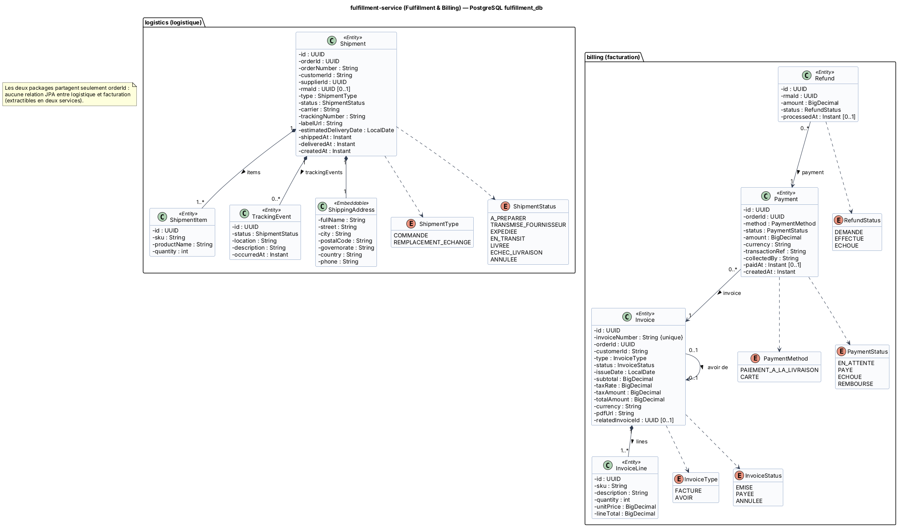

# Fiche 6 — Fulfillment & Billing Service (`fulfillment-service`)

| Élément | Valeur |
|---------|--------|
| Nom technique | `fulfillment-service` (port 8087) |
| Contexte borné | Logistique & facturation (support). Deux modules internes : `logistics` et `billing` |
| Base | PostgreSQL `fulfillment_db` (conteneur `fulfillment-db`) |
| Routes Gateway | `/api/fulfillment/**` |
| Responsable | **Med Ben Lakhal** |

## 1. Responsabilités

**Module `logistics` (logistique) :**
- À la réception de `CommandeValideeEvent` : création d'**une expédition par fournisseur** (dropshipping), génération du **bordereau** (URL du PDF) et transmission au fournisseur.
- Le fournisseur déclare l'**expédition** (transporteur, n° de suivi).
- Réception des **événements de suivi du transporteur** (webhook simulé) : en transit, livré, échec, retard.
- Détection des **retards** (date estimée dépassée) → `LivraisonRetardeeEvent`.
- Agrégation : `CommandeExpedieeEvent` et `CommandeLivreeEvent` ne sont publiés que lorsque **toutes** les expéditions de la commande ont atteint ce statut.
- **Expédition de remplacement** pour un échange.

**Module `billing` (facturation) :**
- **Facture** émise à la validation (TVA 19 %, numérotation séquentielle `FAC-2026-000123`) et **avoir** (`AVO-…`) en cas d'annulation ou de retour.
- **Paiement** : `PAIEMENT_A_LA_LIVRAISON` (`EN_ATTENTE` jusqu'à l'encaissement confirmé par le transporteur) ou `CARTE` (simulée, `PAYE` dès la validation).
- **Remboursement** d'un retour reçu.

**Pourquoi les deux dans un même service (voir P4 dans 00) :** avec le paiement à la livraison, l'encaissement est un événement de livraison. Les deux modules n'ont **aucune relation JPA entre eux** (seul `orderId` est partagé), donc ils restent séparables.

## 2. Entités et attributs

| Entité | Attributs principaux |
|--------|---------------------|
| `Shipment` | `id`, `orderId`, `orderNumber`, `customerId`, `supplierId`, `rmaId`, `type` (COMMANDE, REMPLACEMENT_ECHANGE), `status`, `carrier`, `trackingNumber`, `labelUrl` (bordereau), `shippingAddress`, `estimatedDeliveryDate`, `shippedAt`, `deliveredAt`, `createdAt` |
| `ShipmentItem` | `id`, `sku`, `productName`, `quantity` |
| `TrackingEvent` | `id`, `status`, `location`, `description`, `occurredAt` |
| `Invoice` | `id`, `invoiceNumber` (unique), `orderId`, `customerId`, `type` (FACTURE, AVOIR), `status` (EMISE, PAYEE, ANNULEE), `issueDate`, `subtotal`, `taxRate`, `taxAmount`, `totalAmount`, `currency`, `pdfUrl`, `relatedInvoiceId` |
| `InvoiceLine` | `id`, `sku`, `description`, `quantity`, `unitPrice`, `lineTotal` |
| `Payment` | `id`, `orderId`, `invoice`, `method`, `status` (EN_ATTENTE, PAYE, ECHOUE, REMBOURSE), `amount`, `currency`, `transactionRef`, `collectedBy`, `paidAt`, `createdAt` |
| `Refund` | `id`, `payment`, `rmaId`, `amount`, `status` (DEMANDE, EFFECTUE, ECHOUE), `processedAt` |
| Enum `ShipmentStatus` | A_PREPARER, TRANSMISE_FOURNISSEUR, EXPEDIEE, EN_TRANSIT, LIVREE, ECHEC_LIVRAISON, ANNULEE |

<!-- BEGIN puml:classes-fulfillment-service -->


<details>
<summary>Code PlantUML — <code>../Diagrams/src/classes-fulfillment-service.puml</code></summary>

```plantuml
@startuml classes-fulfillment-service
!include _style.iuml
title fulfillment-service (Fulfillment & Billing) — PostgreSQL fulfillment_db

package "logistics (logistique)" {
  class Shipment <<Entity>> {
    - id : UUID
    - orderId : UUID
    - orderNumber : String
    - customerId : String
    - supplierId : UUID
    - rmaId : UUID [0..1]
    - type : ShipmentType
    - status : ShipmentStatus
    - carrier : String
    - trackingNumber : String
    - labelUrl : String
    - estimatedDeliveryDate : LocalDate
    - shippedAt : Instant
    - deliveredAt : Instant
    - createdAt : Instant
  }
  class ShipmentItem <<Entity>> {
    - id : UUID
    - sku : String
    - productName : String
    - quantity : int
  }
  class TrackingEvent <<Entity>> {
    - id : UUID
    - status : ShipmentStatus
    - location : String
    - description : String
    - occurredAt : Instant
  }
  class ShippingAddress <<Embeddable>> {
    - fullName : String
    - street : String
    - city : String
    - postalCode : String
    - governorate : String
    - country : String
    - phone : String
  }
  enum ShipmentType {
    COMMANDE
    REMPLACEMENT_ECHANGE
  }
  enum ShipmentStatus {
    A_PREPARER
    TRANSMISE_FOURNISSEUR
    EXPEDIEE
    EN_TRANSIT
    LIVREE
    ECHEC_LIVRAISON
    ANNULEE
  }
}
package "billing (facturation)" {
  class Invoice <<Entity>> {
    - id : UUID
    - invoiceNumber : String {unique}
    - orderId : UUID
    - customerId : String
    - type : InvoiceType
    - status : InvoiceStatus
    - issueDate : LocalDate
    - subtotal : BigDecimal
    - taxRate : BigDecimal
    - taxAmount : BigDecimal
    - totalAmount : BigDecimal
    - currency : String
    - pdfUrl : String
    - relatedInvoiceId : UUID [0..1]
  }
  class InvoiceLine <<Entity>> {
    - id : UUID
    - sku : String
    - description : String
    - quantity : int
    - unitPrice : BigDecimal
    - lineTotal : BigDecimal
  }
  class Payment <<Entity>> {
    - id : UUID
    - orderId : UUID
    - method : PaymentMethod
    - status : PaymentStatus
    - amount : BigDecimal
    - currency : String
    - transactionRef : String
    - collectedBy : String
    - paidAt : Instant [0..1]
    - createdAt : Instant
  }
  class Refund <<Entity>> {
    - id : UUID
    - rmaId : UUID
    - amount : BigDecimal
    - status : RefundStatus
    - processedAt : Instant [0..1]
  }
  enum InvoiceType {
    FACTURE
    AVOIR
  }
  enum InvoiceStatus {
    EMISE
    PAYEE
    ANNULEE
  }
  enum PaymentMethod {
    PAIEMENT_A_LA_LIVRAISON
    CARTE
  }
  enum PaymentStatus {
    EN_ATTENTE
    PAYE
    ECHOUE
    REMBOURSE
  }
  enum RefundStatus {
    DEMANDE
    EFFECTUE
    ECHOUE
  }
}
Shipment "1" *-- "1..*" ShipmentItem : items >
Shipment "1" *-- "0..*" TrackingEvent : trackingEvents >
Shipment "1" *-- "1" ShippingAddress
Shipment ..> ShipmentType
Shipment ..> ShipmentStatus
Invoice "1" *-- "1..*" InvoiceLine : lines >
Payment "0..*" --> "1" Invoice : invoice >
Refund "0..*" --> "1" Payment : payment >
Invoice "0..1" --> "0..1" Invoice : avoir de >
Invoice ..> InvoiceType
Invoice ..> InvoiceStatus
Payment ..> PaymentMethod
Payment ..> PaymentStatus
Refund ..> RefundStatus
note "Les deux packages partagent seulement orderId :\naucune relation JPA entre logistique et facturation\n(extractibles en deux services)." as N1
@enduml
```

</details>
<!-- END puml:classes-fulfillment-service -->

## 3. Choix de la base : PostgreSQL

- **Données financières** : transactions ACID obligatoires (facture + lignes + paiement), montants `NUMERIC`, aucune perte tolérée.
- **Numérotation séquentielle sans trou** des factures (exigence légale) : séquences PostgreSQL et contraintes d'unicité.
- Requêtes de reporting (chiffre d'affaires par période, encaissements COD en attente).
- Suivi des expéditions relationnel (expédition → articles → événements de suivi).

## 4. Contrat d'API REST

| Ressource | URI | Méthode | Rôle | Corps / réponse | Codes |
|-----------|-----|---------|------|-----------------|-------|
| Expéditions | `/api/fulfillment/shipments?status=&orderId=&page=` | GET | ADMIN | → `Page<ShipmentDto>` | 200, 403 |
| Mes expéditions | `/api/fulfillment/shipments/mine?status=` | GET | FOURNISSEUR | → `ShipmentDto[]` (à préparer) | 200, 403 |
| Expédition | `/api/fulfillment/shipments/{shipmentId}` | GET | ADMIN, FOURNISSEUR (propriétaire) | → `ShipmentDto` | 200, 403, 404 |
| Bordereau | `/api/fulfillment/shipments/{shipmentId}/label` | GET | ADMIN, FOURNISSEUR (propriétaire) | → `application/pdf` | 200, 403, 404 |
| Expédier | `/api/fulfillment/shipments/{shipmentId}/ship` | POST | FOURNISSEUR (propriétaire), ADMIN | `{carrier, trackingNumber}` → `ShipmentDto (EXPEDIEE)` | 200, 400, 403, 404, 409 (statut invalide) |
| Suivi d'une commande | `/api/fulfillment/orders/{orderId}/tracking` | GET | CLIENT (propriétaire), ADMIN, SUPPORT | → `{shipments[{status, carrier, trackingNumber, events[]}]}` | 200, 403, 404 |
| Webhook transporteur | `/api/fulfillment/carrier-events` | POST | TRANSPORTEUR (client `carrier-simulator`) | `{trackingNumber, status, location, occurredAt, codCollected?, amountCollected?}` | 202, 400, 401, 404 (n° de suivi inconnu) |
| Mes factures | `/api/fulfillment/invoices/me` | GET | CLIENT | → `InvoiceSummaryDto[]` | 200 |
| Factures | `/api/fulfillment/invoices?type=&from=&to=&page=` | GET | ADMIN | → `Page<InvoiceSummaryDto>` | 200, 403 |
| Facture | `/api/fulfillment/invoices/{invoiceId}` | GET | CLIENT (propriétaire), ADMIN | → `InvoiceDto` | 200, 403, 404 |
| Facture (PDF) | `/api/fulfillment/invoices/{invoiceId}/pdf` | GET | CLIENT (propriétaire), ADMIN | → `application/pdf` | 200, 403, 404 |
| Paiement d'une commande | `/api/fulfillment/orders/{orderId}/payment` | GET | CLIENT (propriétaire), ADMIN | → `PaymentDto` | 200, 403, 404 |
| Paiements | `/api/fulfillment/payments?status=&method=&page=` | GET | ADMIN | → `Page<PaymentDto>` | 200, 403 |
| Encaissement manuel COD | `/api/fulfillment/payments/{paymentId}/collect` | POST | ADMIN | `{amountCollected, collectedBy}` → `PaymentDto (PAYE)` | 200, 400, 404, 409 (déjà payé) |
| Remboursements | `/api/fulfillment/refunds?status=` | GET | ADMIN | → `RefundDto[]` | 200, 403 |

## 5. Événements

| Sens | Événement / topic | Contenu | Effet ou consommateurs |
|------|-------------------|---------|------------------------|
| Consommé | **E2** `CommandeValideeEvent` / `commande.validee` | commande complète (lignes avec `supplierId`, adresse, total, mode de paiement) | Facture `EMISE`, paiement (`EN_ATTENTE` si COD, `PAYE` si carte), une `Shipment` par fournisseur avec bordereau |
| Consommé | **E3** `CommandeAnnuleeEvent` / `commande.annulee` | `{orderId, reason}` | Expéditions `ANNULEE` (si non expédiées), avoir, paiement annulé |
| Consommé | **E10** `RetourRecuEvent` / `retour.recu` | `{rmaId, type, items[], refundAmount}` | `RETOUR` : `Refund` + avoir. `ECHANGE` : `Shipment` de type `REMPLACEMENT_ECHANGE` |
| Publié | **E6** `CommandeExpedieeEvent` / `livraison.expediee` | `{eventId, orderId, carrier, trackingNumber, shippedAt}` | order → `EXPEDIEE` |
| Publié | **E7** `CommandeLivreeEvent` / `livraison.livree` | `{eventId, orderId, deliveredAt}` | order → `LIVREE` |
| Publié | **E8** `LivraisonRetardeeEvent` / `livraison.retardee` | `{eventId, orderId, orderNumber, customerId, shipmentId, trackingNumber, expectedDate, delayDays}` | ticketing → ticket automatique |
| Publié | **E11** `RetourFinaliseEvent` / `retour.finalise` | `{eventId, rmaId, outcome, refundId?, shipmentId?, trackingNumber?}` | return → `CLOTUREE` |

## 6. Interactions et comportement en cas de panne

| Interaction | Mode | Données | En cas de panne |
|-------------|------|---------|-----------------|
| Aucun appel synchrone sortant | – | – | **Choix délibéré** : tout ce qui est nécessaire arrive dans les événements (*event-carried state transfer*). Le service ne dépend d'aucun autre à l'exécution. |
| **E2 / E3 / E10** Kafka → fulfillment | Asynchrone | voir ci-dessus | Consommateurs idempotents (une seule facture par `orderId` grâce à une contrainte d'unicité). 3 retries puis DLT. Si le service est arrêté, les commandes confirmées attendent dans Kafka : **aucune perte**, seulement un retard de préparation. |
| **E6, E7, E8, E11** fulfillment → Kafka | Asynchrone | voir ci-dessus | Outbox. Si Kafka est indisponible, les statuts sont mis à jour localement et publiés plus tard. |
| Webhook transporteur indisponible | Entrant | – | Le transporteur réessaie (sémantique *at-least-once*). Le traitement est idempotent par `(trackingNumber, status, occurredAt)`. |
| Fournisseur qui n'expédie pas | Métier | – | Un job détecte les expéditions `TRANSMISE_FOURNISSEUR` au-delà de `shippingDelayDays` → `LivraisonRetardeeEvent` (ticket automatique). |

**Si fulfillment-service tombe :** les clients peuvent toujours commander (les commandes sont confirmées et mises en file dans Kafka). La préparation, le suivi et la facturation reprennent au redémarrage, à partir des offsets Kafka.
