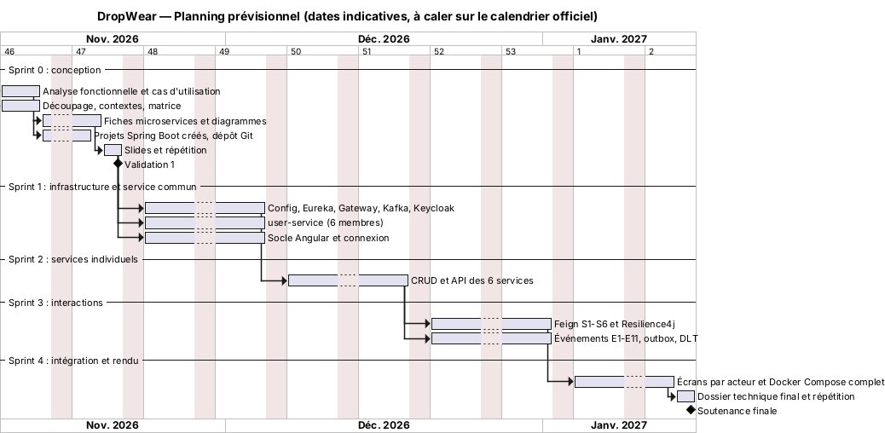
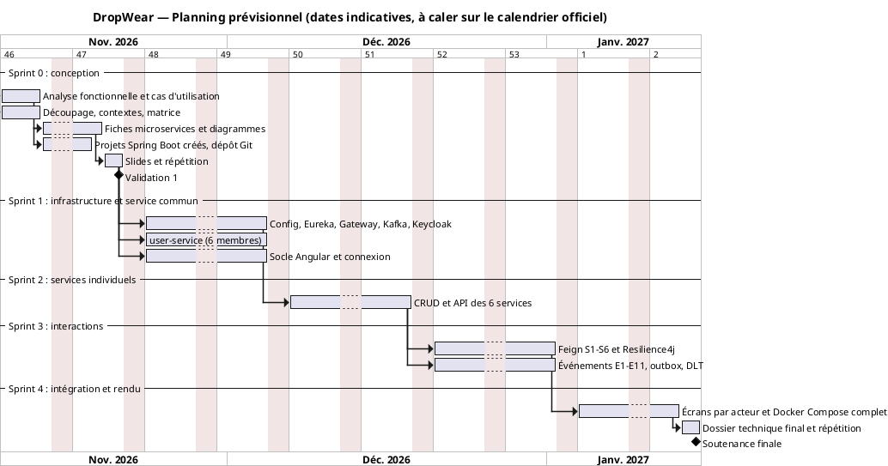

# Livrable 8 — Présentation (14 min 30 + questions)

## 8.1 Répartition équitable de la parole

| Membre | Slides | Temps de parole |
|--------|--------|-----------------|
| Youssef Jaouani | 1, 2, 10, 18 | **2 min 30** |
| Eya Frikha | 3, 4, 9 | **2 min 15** |
| Yasser Chebbi | 5, 11, 16 | **2 min 30** |
| Med Houssaine | 6, 13, 17 | **2 min 30** |
| Aziz Arfaouii | 7, 12 | **2 min 15** |
| Med Ben Lakhal | 8 (service commun), 14, 15 | **2 min 30** |
| **Total** | 18 slides | **14 min 30** |

Écart maximal entre deux membres : 15 s. Si le jury impose 12 min, supprimez la slide 4 (intégrez le périmètre à la 3) et raccourcissez la 7 à 45 s.

**Règles de passage :** chaque orateur annonce le suivant (« Je laisse Yasser vous présenter le découpage »). Le diagramme d'architecture (slide 6) reste affiché en vignette dans un coin des slides 9 à 14 : le service présenté y est surligné.

## 8.2 Plan slide par slide

| # | Titre | Contenu | Visuel | Présentateur | Durée |
|---|-------|---------|--------|--------------|-------|
| 1 | **DropWear** — plateforme e-commerce de vêtements en dropshipping | Titre, classe, groupe, 6 membres, encadrant | Logo, photo de vêtements, noms | Youssef | 0:15 |
| 2 | Problématique et objectifs | 5 problèmes : survente, variantes, retours, COD, support. 3 objectifs. Pourquoi des microservices | 5 icônes et une phrase par problème | Youssef | 1:00 |
| 3 | Acteurs et cas d'utilisation | 4 acteurs principaux + Transporteur et Keycloak. Cas majeurs par acteur | Diagrammes de cas d'utilisation front-office et back-office côte à côte (`uc-*.png`) | Eya | 0:50 |
| 4 | Périmètre V1 | Dans le périmètre / hors périmètre (2 colonnes) | Tableau à 2 colonnes, coches et croix | Eya | 0:25 |
| 5 | Découpage en contextes bornés | DDD : cœur, support, générique. 7 services, 7 bases. « Même SKU, modèles différents » | Carte des contextes (`context-map.png`) + mini-tableau SKU | Yasser | 1:00 |
| 6 | Architecture globale | Front → Gateway → services, Eureka, Config, Keycloak, Kafka, Docker. 12 flux numérotés | `architecture-globale.png` (animation : apparition par blocs) | Med Houssaine | 1:00 |
| 7 | Communication et résilience | Règle sync/async. 6 appels Feign, 11 événements. Timeout, retry, circuit breaker, fallback, outbox, DLT | Séquence de validation de commande (`seq-validation-commande.png`) + tableau Resilience4j | Aziz | 1:15 |
| 8 | Service commun : Auth & Users | Keycloak (realm, rôles, PKCE, JWT), user-service (profils, adresses, fournisseurs), PostgreSQL | Schéma du flux de connexion + diagramme de classes user-service | Med Ben Lakhal | 1:00 |
| 9 | Catalog Service | Variantes (taille × coupe × coloris), MongoDB, API, E1, E4, E5 | Diagramme de classes + extrait du tableau d'API | Eya | 1:00 |
| 10 | Order Service | Panier, cycle de vie (5 statuts), outbox, S1, S2, E2, E3 | Diagramme d'états + diagramme de classes | Youssef | 1:00 |
| 11 | Inventory Service | Réservation 30 min, décrément, alertes. PostgreSQL vs Redis | Cycle de réservation + diagramme de classes | Yasser | 1:00 |
| 12 | Exchange & Return Service | RMA, 14 jours, échange, MySQL, S3, S4, saga retour | Séquence retour/échange (`seq-retour-echange.png`) | Aziz | 1:00 |
| 13 | Ticketing & Support · technologie avancée | Tickets, statuts, WebSocket/STOMP, MongoDB, ticket automatique (E8), mode dégradé | Capture ou maquette du chat + diagramme de classes | Med Houssaine | 1:00 |
| 14 | Fulfillment & Billing Service | Expédition par fournisseur, bordereau, webhook transporteur, COD, factures, zéro appel synchrone | Diagramme de classes (2 packages) | Med Ben Lakhal | 1:00 |
| 15 | Dépôt Git et gestion de projet | Arborescence, Git Flow, Conventional Commits, CODEOWNERS, GitHub Projects | Capture du dépôt + capture du board GitHub Projects | Med Ben Lakhal | 0:30 |
| 16 | Planning prévisionnel et répartition des tâches | 5 sprints, Validation 1 et soutenance finale. Qui fait quoi | Gantt (`planning-gantt.png`) + tableau de répartition | Yasser | 0:30 |
| 17 | Risques et mitigations | 5 risques principaux (voir §8.4) | Matrice probabilité × impact | Med Houssaine | 0:30 |
| 18 | Conclusion | Bilan Validation 1, perspectives, « Merci, place à vos questions » | Architecture en fond, 3 puces | Youssef | 0:15 |

## 8.3 Planning prévisionnel

<!-- BEGIN puml:planning-gantt -->

Code PlantUML — <code>../Diagrams/src/planning-gantt.puml</code>

<!-- END puml:planning-gantt -->

| Sprint | Semaines (indicatif) | Livrable | Jalon |
|--------|----------------------|----------|-------|
| S0 — Conception | 9 → 20 nov. 2026 | Ce dossier, projets créés, dépôt | **Validation 1** |
| S1 — Infrastructure et service commun | 23 nov. → 4 déc. | Config, Eureka, Gateway, Kafka, Keycloak, user-service, socle Angular | Démo de connexion de bout en bout |
| S2 — Services individuels | 7 → 18 déc. | CRUD et API REST des 6 services | Collection Postman verte |
| S3 — Interactions | à partir du 21 déc. (vacances à intégrer) | Feign S1 à S6, événements E1 à E11, Resilience4j | Scénario commande → livraison → retour |
| S4 — Intégration | janvier 2027 | Écrans par acteur, Docker Compose complet, dossier final | **Soutenance finale** |

## 8.4 Risques et mitigations

| # | Risque | Probabilité | Impact | Mitigation |
|---|--------|-------------|--------|------------|
| R1 | ~21 conteneurs : RAM insuffisante sur les PC | Haute | Moyen | Profils Docker Compose (`infra`, `core`, `all`), limites mémoire JVM (`-Xmx256m`), démo sur la machine la plus puissante |
| R2 | Configuration Keycloak (CORS, issuer, rôles) bloquante | Moyenne | Haut | Realm exporté et versionné dès S0, un référent (Med Ben Lakhal), page de procédure dans le README |
| R3 | Contrats d'API ou d'événements incohérents entre services | Moyenne | Haut | Référentiel unique (doc 00), relecture croisée obligatoire, payloads d'événements versionnés (`version`) |
| R4 | Un service en retard bloque l'intégration | Moyenne | Haut | Chaque appel a un fallback. Bouchons (WireMock) pour développer seul. Sprints courts |
| R5 | Ambiguïté de la consigne « microservice 5 (technologie avancée) » | Moyenne | Moyen | Validation écrite auprès de l'enseignant avant la Validation 1 |
| R6 | Perte ou doublon d'événements Kafka | Faible | Haut | Outbox, `acks=all`, consommateurs idempotents, DLT |
| R7 | Front sous-estimé | Haute | Moyen | Socle Angular dès S1, un écran minimal par acteur |
| R8 | Membre absent le jour de la soutenance | Faible | Haut | Chaque binôme de relecture sait présenter le service de l'autre |

## 8.5 Répartition des tâches

| Membre | Service individuel | Part du service commun | Transverse | Documentation |
|--------|--------------------|------------------------|------------|---------------|
| Youssef Jaouani | order-service | UserProfile, `/me` | API Gateway, coordination, dépôt Git | Fiche Order, séquence validation, README |
| Eya Frikha | catalog-service | Address | Frontend (lead) | Analyse fonctionnelle, cas d'utilisation, fiche Catalog |
| Yasser Chebbi | inventory-service | SupplierProfile, administration | Config Server, planning | Découpage, carte des contextes, fiche Inventory |
| Aziz Arfaouii | return-service | Client Keycloak Admin (inscription) | Kafka, résilience | Matrice des interactions, séquence retour, fiche Return |
| Med Houssaine | ticketing-service | Endpoint interne, Dockerfile | Eureka, Docker Compose | Architecture globale, fiche Ticketing, risques |
| Med Ben Lakhal | fulfillment-service | Sécurité, realm Keycloak | Keycloak | Fiche service commun, fiche Fulfillment, Q/R jury |

## 8.6 Scripts oraux

Voir [`scripts-oraux.md`](scripts-oraux.md) : 1 minute maximum par microservice, plus le service commun.
