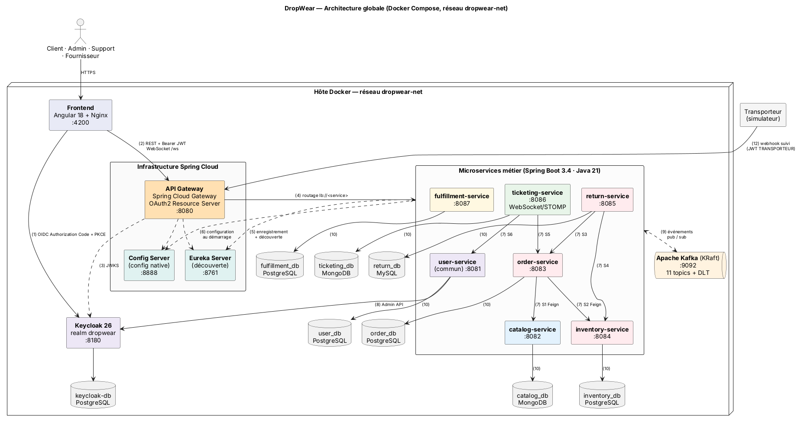

# DropWear — plateforme e-commerce de vêtements en dropshipping

> Mini-projet AWD 2026-2027 · Architecture microservices (Spring Boot, Spring Cloud) · Classe : `CLASSE` · Groupe : `GROUPE`

## 1. Sujet

DropWear vend des vêtements **sans stock propre** : les articles sont expédiés directement par des fournisseurs partenaires. La plateforme doit :
- éviter la **survente** (stock fournisseur, réservation temporaire) ;
- gérer les **variantes** (taille, coupe *boxy* / *oversize*, coloris) ;
- traiter les **retours et échanges** sous 14 jours ;
- gérer le **paiement à la livraison** (COD) et le suivi transporteur ;
- offrir un **support client** traçable, avec messagerie en temps réel.

Acteurs : **Client**, **Admin**, **Support**, **Fournisseur** (+ Transporteur et Keycloak en systèmes externes).

## 2. Membres et responsabilités

| Membre | Microservice | Rôle transverse |
|--------|--------------|-----------------|
| Youssef Jaouani | Order Service | Coordination, dépôt Git, API Gateway |
| Eya Frikha | Catalog Service | Analyse fonctionnelle, Frontend |
| Yasser Chebbi | Inventory Service | Config Server, planning |
| Aziz Arfaouii | Exchange & Return Service | Kafka, résilience |
| Med Houssaine | Ticketing & Support Service | Eureka, Docker Compose |
| Med Ben Lakhal | Fulfillment & Billing Service | Keycloak, présentation du service commun |
| **Toute l'équipe** | **Service commun Auth & Users** (`user-service`) | – |

## 3. Architecture



| Composant | Port | Base de données | Rôle |
|-----------|------|-----------------|------|
| frontend (Angular) | 4200 | – | Interfaces client, admin, support et fournisseur |
| api-gateway | 8080 | – | Point d'entrée unique, validation JWT, routage `lb://` |
| eureka-server | 8761 | – | Découverte de services |
| config-server | 8888 | – | Configuration centralisée (`config/*.yml`) |
| keycloak | 8180 | keycloak-db (PostgreSQL) | OAuth2 / OIDC, realm `dropwear` |
| kafka (+ kafka-ui) | 9092 (8090) | – | Événements de domaine (11 topics + DLT) |
| user-service (commun) | 8081 | PostgreSQL `user_db` | Profils, adresses, rôles, fournisseurs |
| catalog-service | 8082 | MongoDB `catalog_db` | Produits, variantes, images, catégories |
| order-service | 8083 | PostgreSQL `order_db` | Panier, commande, cycle de vie |
| inventory-service | 8084 | PostgreSQL `inventory_db` | Stock, réservations, alertes |
| return-service | 8085 | MySQL `return_db` | RMA, retours, échanges, étiquettes |
| ticketing-service | 8086 | MongoDB `ticketing_db` | Tickets, messagerie WebSocket |
| fulfillment-service | 8087 | PostgreSQL `fulfillment_db` | Expéditions, factures, paiements COD |

**Communication**
- Synchrone (OpenFeign + Resilience4j, endpoints `/internal/**` non exposés) : S1 order→catalog, S2 order→inventory, S3 return→order, S4 return→inventory, S5 ticketing→order, S6 ticketing→user.
- Asynchrone (Kafka) : `CommandeValideeEvent` (order → inventory + fulfillment) et 10 autres événements. Voir [la matrice](Documentation/04-matrice-interactions.md).

## 4. Lancement

### Prérequis
Docker Desktop (8 Go de RAM minimum alloués pour tout lancer), Java 21, Maven 3.9.

### Option A — développement (un membre travaille sur son service)

```bash
cp .env.example .env
docker compose --profile infra up -d
```

```bash
mvn -f Backend/pom.xml package -DskipTests
```

Lancer ensuite, dans cet ordre et depuis l'IDE (ou avec `java -jar Backend/<projet>/target/<projet>-0.1.0-SNAPSHOT.jar`) : `config-server`, `eureka-server`, `api-gateway`, puis le ou les services voulus. Les valeurs par défaut pointent vers `localhost`.

### Option B — démonstration complète

```bash
docker compose --profile all up -d --build
```

### URL utiles

| URL | Contenu |
|-----|---------|
| http://localhost:8080/api/... | API (via la Gateway) |
| http://localhost:8761 | Tableau de bord Eureka |
| http://localhost:8180 | Console Keycloak (`admin` / `admin`) |
| http://localhost:8090 | Kafka UI (topics, messages, DLT) |
| http://localhost:8888/order-service/default | Configuration servie à order-service |

### Comptes de test (realm `dropwear`, développement uniquement)

| Utilisateur | Mot de passe | Rôle |
|-------------|--------------|------|
| `client1` | `Passw0rd!` | CLIENT |
| `admin1` | `Passw0rd!` | ADMIN |
| `support1` | `Passw0rd!` | SUPPORT |
| `fournisseur1` | `Passw0rd!` | FOURNISSEUR |

Obtenir un jeton (tests Postman ou curl) :

```bash
curl -s -d "grant_type=password&client_id=dropwear-frontend&username=client1&password=Passw0rd!" http://localhost:8180/realms/dropwear/protocol/openid-connect/token
```

### État à la Validation 1
Les projets sont **créés et démarrent**. Chaque endpoint du contrat répond `501 Not Implemented`, puisqu'aucune logique métier n'est attendue. La sécurité, le routage, la découverte, la configuration et la messagerie fonctionnent déjà :

| Vérification | Résultat attendu |
|--------------|------------------|
| `GET /api/catalog/products` sans jeton | `501` (public, routé) |
| `GET /api/orders/me` sans jeton | `401` |
| `GET /api/orders/me` avec le jeton de `client1` | `501` |
| `GET /api/orders` avec le jeton de `client1` (réservé ADMIN / SUPPORT) | `403` |
| `GET /internal/orders/{id}` via la Gateway | `403` (jamais exposé) |
| Message publié sur `commande.validee` | reçu par inventory-service **et** fulfillment-service |
| Message invalide | 3 nouvelles tentatives puis `commande.validee.DLT` |

## 5. Arborescence

```
Backend/        un projet Spring Boot par microservice + config-server, eureka-server, api-gateway
                infrastructure/ (realm Keycloak, script des topics Kafka)
Frontend/       application Angular
Documentation/  conception (livrables 00 à 09), Fiches/, Diagrams/ (PlantUML + PNG/SVG), Presentation/
```

Point d'entrée de la documentation : [`Documentation/00-synthese-hypotheses-points-attention.md`](Documentation/00-synthese-hypotheses-points-attention.md).

## 6. Conventions Git

- Branches : `main` (versions présentées, tags `v0.1-validation1`…), `develop` (intégration), `feature/<service>/<sujet>`, `docs/<sujet>`, `fix/<service>/<sujet>`.
- Pull request vers `develop` avec 1 relecture obligatoire (voir `.github/CODEOWNERS`).
- Commits : *Conventional Commits*, par exemple `feat(order): add cart endpoints skeleton`.
- Suivi : GitHub Projects (backlog initial dans `Documentation/backlog-initial.csv`).
